# SPARK — Native Windows AI Workstation & Autonomous Agent Hub

<p align="center">
  
</p>

<p align="center">
  <strong>An intelligent, native Windows desktop workstation combining multi-division productivity, autonomous agent execution, local and cloud AI inference, and a Sci-Fi voice HUD.</strong><br>
  <em>Created and Led by <strong>Haani Faad</strong> • With Project Contributors <strong>Simin Ajmal</strong>, <strong>Muhammed Yaseen</strong>, and <strong>Najid</strong></em>
</p>

<p align="center">
  <a href="https://github.com/haanifaad/Spark/releases/tag/v1.0.0"></a>
  <a href="https://dotnet.microsoft.com/download/dotnet/10.0"></a>
  <a href="https://learn.microsoft.com/windows/apps/windows-app-sdk/"></a>
  <a href="https://nodejs.org/"></a>
  <a href="https://www.python.org/"></a>
  <a href="LICENSE"></a>
</p>

---

## Table of Contents

1. [Project Title — SPARK](#1-project-title--spark)
2. [Project Overview](#2-project-overview)
3. [Project Vision and Objectives](#3-project-vision-and-objectives)
4. [Key Features](#4-key-features)
5. [Feature Descriptions (The Five Divisions)](#5-feature-descriptions-the-five-divisions)
6. [User Interface and Experience](#6-user-interface-and-experience)
7. [System Architecture](#7-system-architecture)
8. [AI Architecture and Integration](#8-ai-architecture-and-integration)
9. [Voice Assistant Architecture](#9-voice-assistant-architecture)
10. [Browser and Computer Interaction](#10-browser-and-computer-interaction)
11. [Automation Capabilities](#11-automation-capabilities)
12. [Memory System](#12-memory-system)
13. [Technology Stack](#13-technology-stack)
14. [Project Directory Structure](#14-project-directory-structure)
15. [Installation Requirements](#15-installation-requirements)
16. [Installation Guide](#16-installation-guide)
17. [Configuration and Environment Variables](#17-configuration-and-environment-variables)
18. [Running SPARK](#18-running-spark)
19. [Development Workflow](#19-development-workflow)
20. [API and Backend Architecture](#20-api-and-backend-architecture)
21. [Security and Privacy](#21-security-and-privacy)
22. [Screenshots and Visual Documentation](#22-screenshots-and-visual-documentation)
23. [Current Development Status](#23-current-development-status)
24. [Known Limitations](#24-known-limitations)
25. [Future Development Roadmap](#25-future-development-roadmap)
26. [Contributors](#26-contributors)
27. [License](#27-license)

---

## 1. Project Title — SPARK

**SPARK** is a native Windows AI Workstation and Autonomous Agent Platform. It unifies conversational intelligence, multi-agent background automation, local GGUF inference, desktop computer control, and real-time voice communication into a single, cohesive, high-performance desktop environment built specifically for Windows 11 and Windows 10.

---

## 2. Project Overview

SPARK bridges the gap between web-based LLM chat interfaces and true system-level agent execution. Unlike traditional web wrappers or electron-based apps, SPARK is engineered from the ground up as a native Windows client using **.NET 10** and **WinUI 3 (Windows App SDK 1.6)**, integrated with a managed, sandboxed **OpenClaw Gateway** running in an embedded Node.js process and a dedicated Python voice runtime daemon.

SPARK organizes user workflows into **Five Specialized Divisions**:
- **Chat**: General-purpose conversational intelligence with multi-model routing, reasoning effort selection, and session branching.
- **Work**: Autonomous personal agent deck featuring goal decomposition, proactive background routines, Model Context Protocol (MCP) tool execution, and collaborative multi-agent Team Rooms.
- **Code**: An integrated developer environment with project exploration, terminal execution, code intelligence, and a cybersecurity vulnerability auditing engine.
- **Study**: Academic research and synthesis workspace featuring concept breakdowns, structured note generation, and citation tracking.
- **Creative**: A 16-app creative studio suite covering vector design, typography, shaders, sound design, video editing, and motion graphics.

Additionally, SPARK features an immersive **Voice Mode (Mark-LVII HUD)** featuring a Sci-Fi holographic interface, pulsating Arc Reactor visualization, interactive 3D face mesh, multi-engine speech synthesis (EdgeTTS, Kokoro, ElevenLabs), real-time speech recognition (faster-whisper, Malayalam STT), and Gemini Live bidirectional streaming.

---

## 3. Project Vision and Objectives

1. **Native Windows Integration**: Eliminate the performance and memory overhead of Electron and virtualization containers (WSL/Docker) by providing a lightweight, hardware-accelerated WinUI 3 interface with native Windows API access.
2. **Local-First Privacy & Independence**: Deliver full offline local inference capabilities via an embedded, supervised `llama-server` process with GGUF model support and automated hardware qualification.
3. **Autonomous Task Execution with Human Oversight**: Enable agents to perform complex, multi-step actions across file systems, developer tools, and desktop applications while enforcing strict **Sentinel** Human-in-the-Loop approvals for high-impact mutations.
4. **Multimodal Grounded Interaction**: Empower agents to perceive the desktop screen via high-speed capture and interact with arbitrary Windows applications using normalized coordinate grounding (UI-TARS 1000).
5. **Division-Segmented Workflows**: Separate context, memory journals, system instructions, and tool sets into distinct operational spaces so that specialized tasks do not pollute general conversation history.

---

## 4. Key Features

- **Fluent WinUI 3 Desktop Experience**: Mica and Acrylic backdrop materials, smooth XAML animations, light/dark theme adaptation, and native system tray integration with instant quick flyouts.
- **Process Supervisor & Zero-Orphan Isolation**: Managed gateway runtime bound to Win32 Job Objects with `JOB_OBJECT_LIMIT_KILL_ON_JOB_CLOSE` (`0x2000`), guaranteeing that backend processes, local inference servers, and Python workers terminate immediately when SPARK exits.
- **Dual Inference Engine**:
  - **Local Offline Inference**: Integrated `llama-server` supervisor (`http://127.0.0.1:18803/v1`) with hardware capability checks (AVX2, AVX-512, CUDA compute capability, VRAM qualification) and Ollama bridge.
  - **Cloud Model Providers**: Anthropic Claude (Sonnet 3.5/3.7, Opus), OpenAI (GPT-4o, o1, o3-mini), Google Gemini (2.0 Flash / Pro), Groq (Llama 3.3 70B), Mistral, and custom OpenAI-compatible endpoints.
- **Voice Mode (Mark-LVII HUD)**:
  - Deep blue Sci-Fi holographic UI.
  - Centered pulsating Arc Reactor visualizer with dynamic audio reactivity.
  - Interactive 3D face mesh (`face_model.obj`) rendered via OpenGL/PyQt.
  - Speech synthesis via EdgeTTS, Kokoro-82M, and ElevenLabs.
  - Local GPU/CPU speech transcription via faster-whisper, Sherpa-ONNX, and Malayalam STT.
  - Real-time barge-in and Voice Activity Detection (VAD) for instant speech interruption.
- **Computer Use & Desktop Automation**:
  - UI-TARS 1000-normalized coordinate grounding engine.
  - Direct Win32 input injection (SendInput mouse moves, clicks, drag-and-drop, keyboard input).
  - High-performance GDI+ and Windows Graphics Capture screen perception.
  - `ComputerUseSafetyGuard` with persistent JSON authorization storage and emergency kill switches.
- **Model Context Protocol (MCP)**:
  - Built-in MCP HTTP server bridge (`http://127.0.0.1:18793`) for standard tool discovery and execution.
- **Autonomous Multi-Agent Collaboration**:
  - Multi-agent Team Rooms with cross-agent message dispatch and coordination.
  - Configurable personas, role definitions, and system prompts.
- **Structured Memory Journal**:
  - SQLite WAL persistent storage for learned facts, topic memories, and contextual retention.
  - Strict privacy separation across divisions.

---

## 5. Feature Descriptions (The Five Divisions)

SPARK organizes cognitive and creative tasks into five distinct divisions accessible via the unified title bar:

```
[ Chat ]   [ Work ]   [ Code ]   [ Study ]   [ Creative ]   [ Voice Mode ]
```

### 1. Chat Division
The primary conversational intelligence environment:
- **Streaming Responses**: Real-time token streaming with Markdown formatting, LaTeX math formulas, tables, and copy-ready syntax-highlighted code blocks.
- **Reasoning Picker**: Interactive flyout allowing users to choose reasoning effort (`off`, `low`, `medium`, `high`) and inspect chain-of-thought steps.
- **Session Branching & History**: Branch existing conversations into new threads, search message history, and export session transcripts.
- **Multimodal Uploads**: Drag-and-drop support for local images, documents, and code files.

<p align="center">
  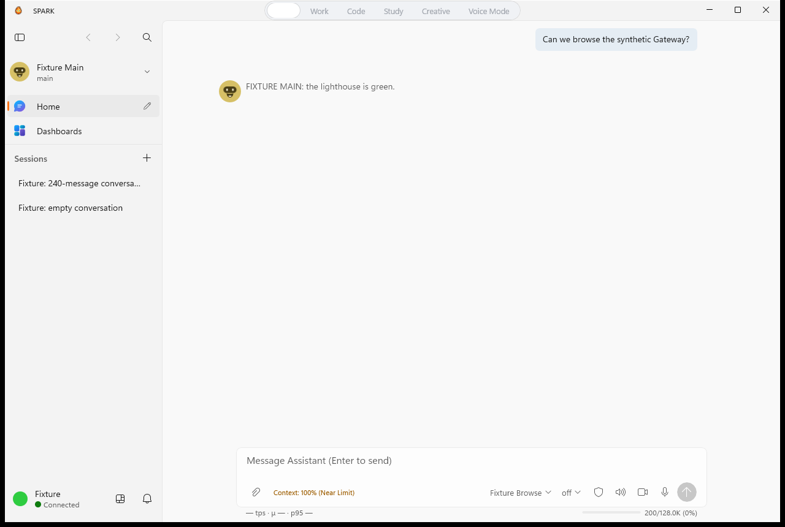
</p>

### 2. Work Division (Autonomous Personal Agent)
A specialized operations deck for autonomous agents:
- **Autonomous Background Worker**: Launch long-running, multi-step tasks with autonomous planning and goal decomposition.
- **Proactive Routines & Cron Schedules**: Configure background automations, recurring morning briefings, and system monitoring tasks.
- **Tools & MCP Registry**: Real-time table of registered tool capabilities, tool execution permissions, and invocation counters.
- **Team Rooms**: Multi-agent workspaces where specialized agent personas (e.g., Researcher, Coder, Reviewer) collaborate on complex workflows.
- **Approvals & Forensic Audit**: Tamper-evident ledger of all agent-initiated system actions, file modifications, and pending approvals.
- **Channels Integration**: Webhook and messaging bridge connections to Slack, Discord, Telegram, WhatsApp, and Email.

<p align="center">
  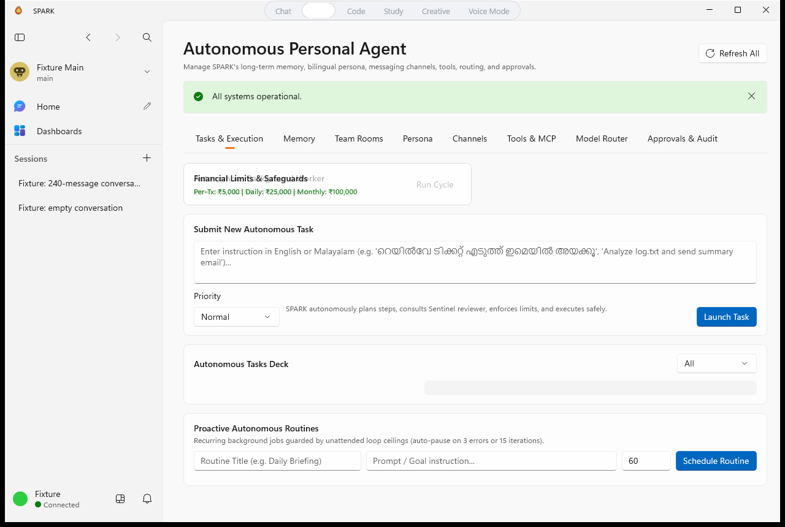
</p>

### 3. Code Division
A native developer workspace built for software engineering:
- **Project File Explorer**: Navigate workspace repositories, read directory structures, and inspect file trees.
- **Multi-Tab Code Editor**: Tabbed code viewer with syntax highlighting and quick-edit capabilities.
- **Interactive Developer Console**: Embedded Win32 terminal shell for executing build scripts, package managers, and Git operations.
- **Security & Vulnerability Audit Engine**: Code security auditing engine that scans repository dependencies for CVEs, credential leaks, and insecure API usage.

<p align="center">
  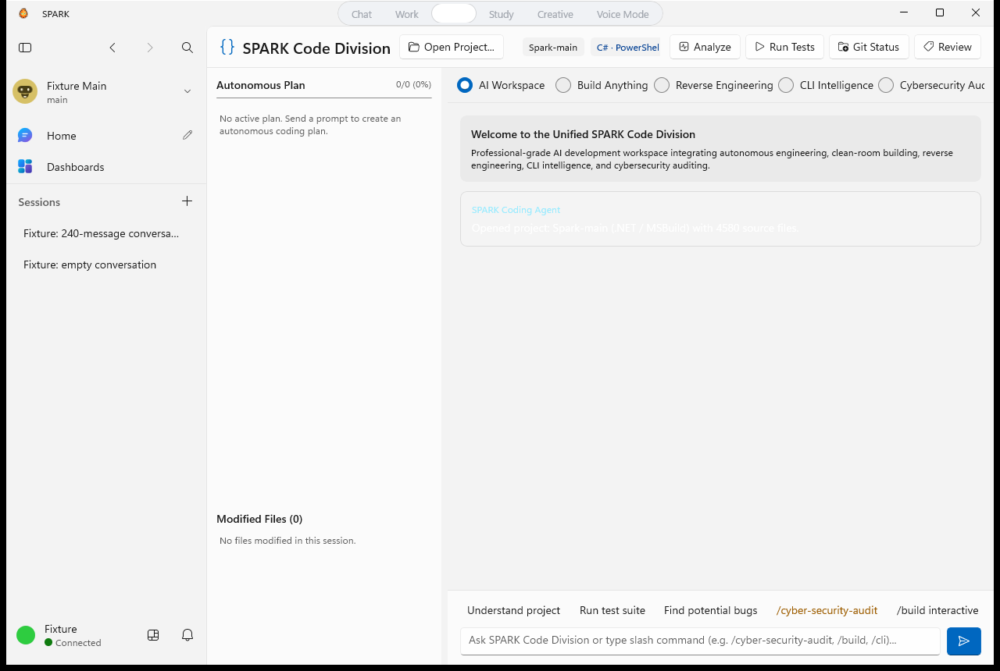
</p>

### 4. Study Division
An academic, research-oriented workspace:
- **Deep Concept Breakdown**: Break complex topics into structured syllabi, conceptual hierarchies, and key principles.
- **Research Synthesis & Summaries**: Ingest long documents and extract key insights, definitions, and action items.
- **Citation & Source Tracking**: Maintain references to source documents, research papers, and web URLs.
- **Interactive Flashcards & Quiz Generation**: Automatically produce active recall flashcards from loaded documents.

### 5. Creative Division (16-App Studio Suite)
A complete creative workstation featuring 16 integrated studio applications:
- **VectorSpark**: Vector graphics and illustration studio featuring Bézier curve tools, layer hierarchies, SVG import/export, and mascot design.
- **WordSpark**: Typography, document publishing, Markdown authoring, and diff tracking.
- **GridSpark**: Layout design, tabular data visualizer, and structured data grids.
- **TextureSpark**: Procedural shader generation, material maps, and texture synthesis.
- **SoundSpark**: Audio generation, waveform synthesis, sound effects, and voice modulation.
- **FilmSpark**: Video editing, motion graphics, and chroma-key green screen processing.
- Additional 10 specialized studio modules covering 3D asset generation, color palettes, animations, and typography styling.

<p align="center">
  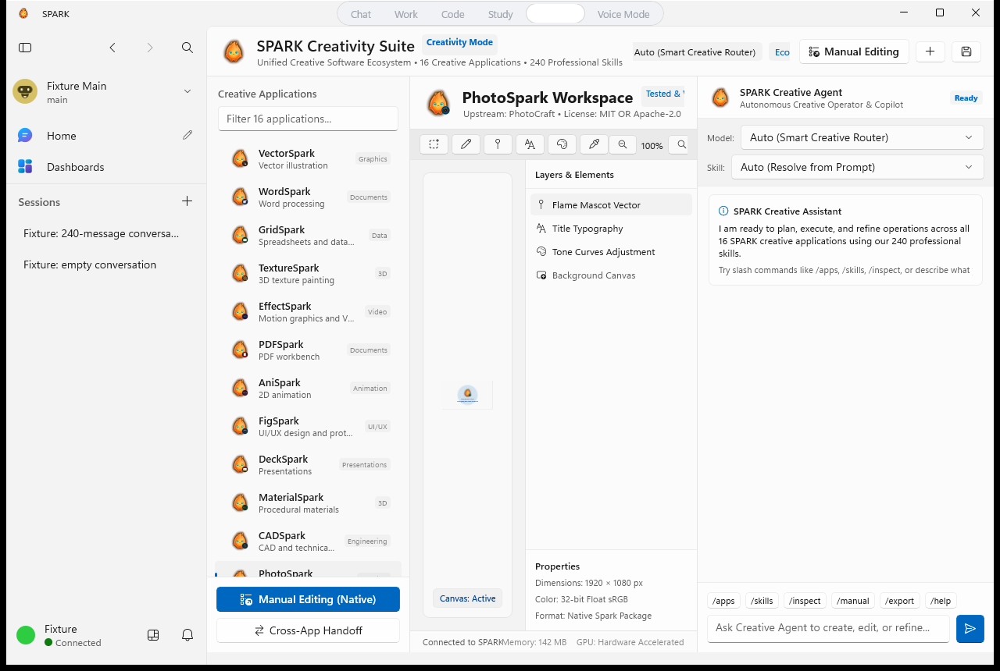
</p>

---

## 6. User Interface and Experience

SPARK adheres strictly to the **Windows 11 Fluent Design System**:

- **Backdrop & Materials**: Native Windows Mica material for window backdrops and Acrylic for transient menus, popovers, and flyouts.
- **Unified TitleBar & Division Switcher**: Clean, integrated title bar with window controls, global search icon, notifications bell, and active division tabs.
- **Universal Command Palette (`Ctrl+Shift+P`)**: Global command center enabling instant navigation, model selection, tool execution, and division switching.
- **System Tray Quick Access**: Native tray icon with flyout menu for quick chat queries, gateway status checks, memory inspection, and instant workspace launch.
- **Notifications Inbox**: Consolidated notification stream displaying agent completion alerts, system health updates, and pending human-in-the-loop approvals.
- **Accessibility & Display Scaling**: Full support for high-DPI displays (100% to 300%), keyboard navigation, and high-contrast themes.

<p align="center">
  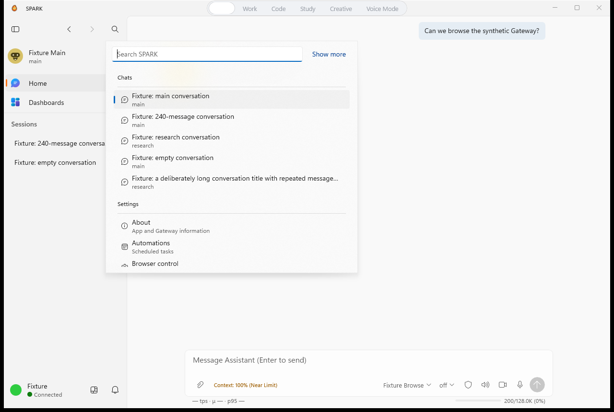
</p>

---

## 7. System Architecture

SPARK operates as a multi-process architecture with strict process isolation and communication contracts:

```text
+-----------------------------------------------------------------------------------+
|                           SPARK (WinUI 3 Desktop Client)                          |
|                                                                                   |
|  +--------------------+  +-----------------------+  +--------------------------+  |
|  |    TitleBar &      |  |   Workspace Shell     |  |    Settings & Hubs       |  |
|  | Division Switcher  |  | (Chat / Work / Code)  |  |  (Models, Local AI, VAD) |  |
|  +---------+----------+  +-----------+-----------+  +------------+-------------+  |
|            |                         |                           |                |
|            +--------------------+----+---------------------------+                |
|                                 |                                                 |
|                 +---------------v---------------+                                 |
|                 |  SparkManagedGatewayRuntime   |                                 |
|                 | (Win32 Job Object Supervisor) |                                 |
|                 +---------------+---------------+                                 |
+---------------------------------|-------------------------------------------------+
                                  |
              +-------------------+-------------------+
              |                                       |
    HTTP /health probe &                   WebSocket ws://127.0.0.1:18789
    Process lifecycle control              (Ed25519 Auth Handshake / JSON-RPC)
              |                                       |
              v                                       v
+-----------------------------+     +-----------------------------------------------+
|  Local Inference Supervisor |     |      OpenClaw Managed Gateway (Node.js)       |
|  (llama-server :18803)      |     |                                               |
|  - GGUF Model Runtime       |     |  +---------------------+  +-----------------+ |
|  - Hardware Qualification   |     |  |   Agent Executor    |  |  SQLite WAL DB  | |
|  - CUDA/AVX2 Auto-Detection |     |  | (Ollama / Claude)   |  | (Sessions/State)| |
+-----------------------------+     |  +----------+----------+  +-----------------+ |
                                    |             |                                 |
                                    |  +----------v----------+  +-----------------+ |
                                    |  |  Desktop Operator   |  |   MCP Server    | |
                                    |  | (UI-TARS Grounding) |  | (Bridge :18793) | |
                                    |  +---------------------+  +-----------------+ |
                                    +-----------------------------------------------+
                                                      |
                                       JSON IPC stdin/stdout & Local Socket
                                                      |
                                                      v
                                    +-----------------------------------------------+
                                    |      Python Voice Mode Daemon (Mark-LVII)     |
                                    |  - Arc Reactor & 3D Mesh (PyQt / OpenGL)      |
                                    |  - faster-whisper STT & Malayalam STT         |
                                    |  - EdgeTTS / Kokoro / ElevenLabs TTS          |
                                    |  - Gemini Live Bidirectional WebSockets       |
                                    +-----------------------------------------------+
```

### Process Supervision & Job Objects
All spawned child processes (Gateway Node.js, `llama-server`, Python voice daemon) are enrolled into a Windows Win32 Job Object configured with:
```csharp
JOBOBJECT_EXTENDED_LIMIT_INFORMATION limits = new();
limits.BasicLimitInformation.LimitFlags = JOB_OBJECT_LIMIT_KILL_ON_JOB_CLOSE; // 0x2000
```
This guarantees zero orphaned processes: closing or terminating the main SPARK window instantly and cleanly closes all background workers.

---

## 8. AI Architecture and Integration

### 1. Local Offline Inference (`llama-server`)
SPARK features a first-class local inference supervisor that runs native `llama-server` binaries on loopback port `18803`:
- **Hardware Qualification Probe**: Prior to starting, SPARK analyzes host capabilities:
  - CPU Instruction Set: AVX, AVX2, AVX-512, NEON.
  - System Memory: Total and available RAM allocation.
  - GPU Acceleration: NVIDIA CUDA detection, driver version verification (e.g., Driver 391.35+ vs modern 550+), Compute Capability (e.g., CC 3.5, 5.0, 7.5, 8.9), and dedicated VRAM headroom.
- **Model Registry & Auto-Discovery**: Automatically recognizes downloaded GGUF weights, checks quantizations (Q4_K_M, Q8_0, etc.), and configures context window and KV-cache parameters.
- **Ollama Integration**: Seamlessly detects and proxies to locally installed Ollama daemon instances (`http://127.0.0.1:11434`).

<p align="center">
  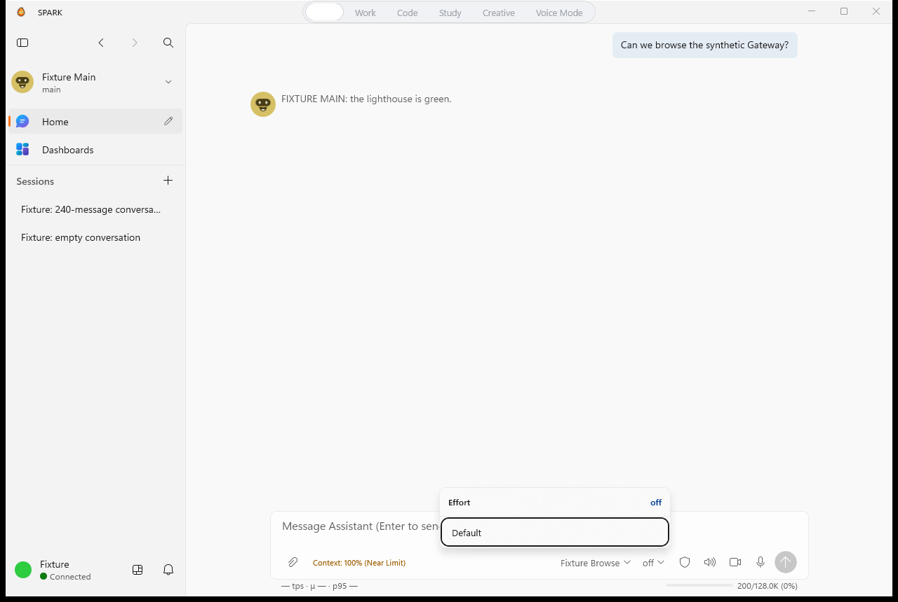
</p>

### 2. Cloud AI Providers
SPARK integrates with enterprise cloud model APIs via encrypted credential management:
- **Anthropic**: Claude 3.5 Sonnet, Claude 3.7 Sonnet (with Extended Thinking), Claude 3 Opus.
- **OpenAI**: GPT-4o, GPT-4o-mini, o1, o3-mini.
- **Google**: Gemini 2.0 Flash, Gemini 2.0 Pro, Gemini 1.5 Pro.
- **Groq**: Llama-3.3-70B-Versatile, Mixtral-8x7B (ultra-low-latency streaming).
- **Custom OpenAI-Compatible Endpoints**: Local vLLM, LM Studio, or self-hosted API gateways.

### 3. Intelligent Model Router
SPARK's Work Division includes an automated model router that dispatches requests based on task type:
- Fast routine tasks $\rightarrow$ Local Ollama / Groq.
- Deep reasoning & architectural code $\rightarrow$ Claude 3.7 Sonnet / o1.
- Cost/latency failover: If an external cloud provider encounters rate limits (HTTP 429), the router cascades to backup providers or local inference.

---

## 9. Voice Assistant Architecture

SPARK includes a dedicated Sci-Fi voice workstation inspired by the **Mark-LVII HUD**:

<p align="center">
  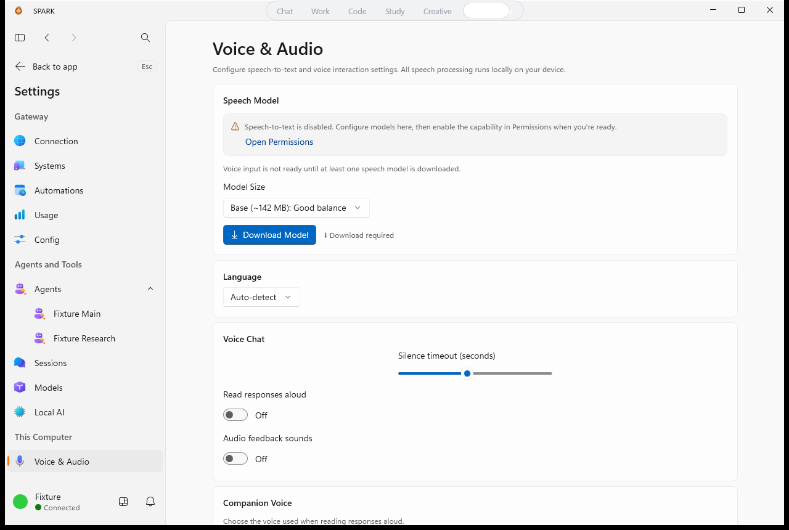
</p>

### Key Voice Capabilities
1. **Mark-LVII Holographic HUD**:
   - Deep blue `#001830` aesthetic with glowing cyan accents.
   - Central pulsating **Arc Reactor** whose rotation and flare scale in real time with audio input/output amplitudes.
   - 3D face mesh (`face_model.obj`) rendered via OpenGL with dynamic facial deformation.
2. **Speech-to-Text (STT)**:
   - **Local faster-whisper**: Real-time transcription running on CUDA or CPU with minimal latency.
   - **Sherpa-ONNX**: Lightweight on-device ASR models.
   - **Malayalam Speech Recognition**: Specialized STT pipelines for accurate regional language input.
3. **Text-to-Speech (TTS)**:
   - **EdgeTTS**: High-fidelity, zero-cost cloud voices across hundreds of locales.
   - **Kokoro-82M**: Ultra-fast, lightweight 82M parameter local neural TTS engine.
   - **ElevenLabs**: High-definition expressive voice synthesis via API.
4. **Gemini Live Integration**:
   - Real-time bidirectional audio streaming via WebSockets for low-latency conversational banter.
5. **Barge-In & Voice Activity Detection (VAD)**:
   - Silero VAD monitors microphone input; speaking while the assistant is talking instantly mutes playback and flushes synthesis buffers.

---

## 10. Browser and Computer Interaction

SPARK provides autonomous agents with safe, grounded desktop interaction capabilities:

<p align="center">
  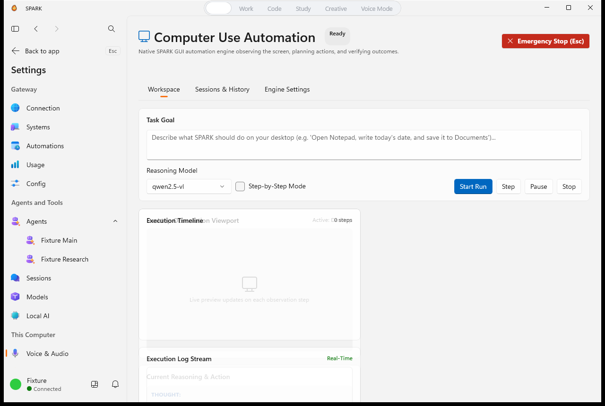
</p>

- **Perception Engine**:
  - Captures multi-monitor desktop screenshots via GDI+ and Windows Graphics Capture.
  - Automatically compensates for display DPI scaling factors (100% to 250%).
- **UI-TARS 1000 Grounding**:
  - Translates visual coordinate predictions normalized to a 1000x1000 grid into exact host pixel coordinates across virtual desktop bounding boxes.
- **Desktop Operator**:
  - Injects mouse movement, left/right/middle clicks, double-clicks, drag-and-drop operations, and keyboard text inputs via native Win32 `SendInput` APIs.
- **ComputerUseSafetyGuard**:
  - **Local Authorization Ledger**: Saves user-granted desktop permissions persistently in encrypted JSON configuration.
  - **Restricted Zones**: Blocks mouse actions from clicking system-critical zones (taskbar system tray, UAC dialogs, admin consoles).
  - **Emergency Kill Switch**: Pressing `Ctrl+Shift+Escape` or moving the physical mouse forcefully cancels active agent execution immediately.

---

## 11. Automation Capabilities

<p align="center">
  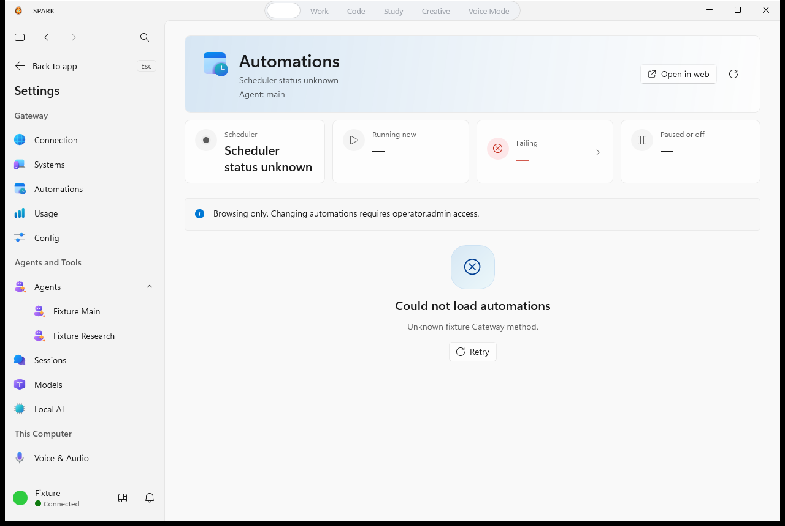
</p>

- **Cron Schedules**: Create standard 5-part cron expressions (e.g., `0 9 * * 1-5`) to trigger autonomous tasks automatically.
- **Interval Timers**: Execute recurring agent workflows every $N$ minutes or hours.
- **Proactive Routines**:
  - Daily Morning Briefing: Synthesizes unread emails, calendar events, and top news.
  - Repository Health Scan: Runs security audits and dependency updates on active coding projects.
  - System Telemetry & Cleanup: Monitors disk space and memory leaks across long-running developer servers.

---

## 12. Memory System

<p align="center">
  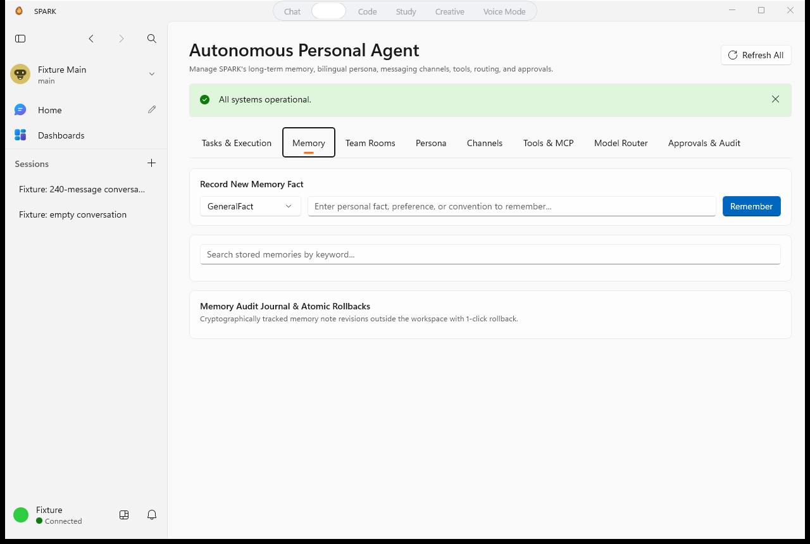
</p>

- **Structured Memory Journal**: Backed by a high-performance SQLite database in Write-Ahead Logging (WAL) mode.
- **Automatic Fact Extraction**: The agent automatically identifies and extracts user preferences, technical constraints, and personal facts from conversations.
- **Division-Level Segregation**: Keeps work-related project memories separate from personal chat conversations to prevent context contamination.
- **Inspectable & Editable**: Users can view the full memory ledger, search for specific stored facts, manually edit records, or permanently delete individual memories.

---

## 13. Technology Stack

| Layer | Technologies & Frameworks | Description |
|---|---|---|
| **Frontend UI** | .NET 10.0, Windows App SDK 1.6 / WinUI 3, CommunityToolkit.Mvvm | Native Windows 11 Fluent interface, Mica backdrops, hardware acceleration. |
| **WebView Engine** | Microsoft Edge WebView2 Evergreen | High-performance HTML5/Canvas rendering and interactive UI previewing. |
| **Gateway Supervisor** | C# .NET 10 Class Libraries (`OpenClaw.Shared`, `OpenClaw.Connection`) | Win32 Job Object supervisor, process lifecycle management, health monitoring. |
| **Backend Gateway** | Node.js v22.x / v26.x LTS, TypeScript, `node:sqlite` | Asynchronous agent runtime, WebSocket JSON-RPC server, tool execution engine. |
| **Local LLM Engine** | `llama.cpp` (`llama-server`), GGUF quantizations, CUDA runtime | Standalone local inference server running on loopback port `18803`. |
| **Voice Runtime** | Python 3.10+, PyQt6, OpenGL, faster-whisper, EdgeTTS, sounddevice | Dedicated Sci-Fi HUD daemon, 3D face mesh, neural STT/TTS, audio streaming. |
| **Computer Control** | Win32 API (`SendInput`, `GetCursorPos`), GDI+, Windows Graphics Capture | Native screen capture perception and hardware input injection. |
| **Database & Cache** | SQLite 3 (WAL mode), DPAPI-encrypted JSON stores | Low-latency local storage for sessions, memories, and security credentials. |
| **Packaging & CI** | Inno Setup 6 (`ISCC.exe`), PowerShell 7, GitHub Actions | Self-contained single-file installer generator (`SPARK-Setup.exe`). |

---

## 14. Project Directory Structure

```text
Spark-main/
├── docs/                           # Documentation, guides, and screenshot assets
│   ├── screenshots/                # Comprehensive 40-screen UI inventory
│   ├── images/                     # Architecture diagrams and setup graphics
│   └── release/                    # Dependency audits and compliance reports
├── Documentation/                  # Formal engineering & production audit reports
│   ├── AUDIT_REPORT.md             # Complete production code audit
│   ├── BUG_TRACKER.md              # 10 confirmed architectural bugs & resolutions
│   ├── SECURITY_AUDIT.md           # Cryptographic & process boundary audit
│   └── FINAL_RELEASE_REPORT.md     # Production release qualification dossier
├── installer/                      # Inno Setup 6 installer definition scripts
│   └── installer.iss               # Production installer script
├── scripts/                        # Automation & deployment scripts
│   ├── build-inno-local.ps1        # Automated Inno Setup installer compiler
│   └── run-desktop.ps1             # Local development launch runner
├── src/                            # Production C# and TypeScript source code
│   ├── OpenClaw.Chat/              # Conversational UI controls and Markdown rendering
│   ├── OpenClaw.Connection/        # Gateway WebSocket RPC & Ed25519 authentication
│   ├── OpenClaw.SetupEngine/       # Prerequisites verification & setup wizard
│   ├── OpenClaw.Shared/            # Core business logic, models, inference probes
│   │   ├── ComputerUse/            # Desktop perception & input injection engine
│   │   ├── Inference/              # llama-server supervisor & CUDA hardware probes
│   │   ├── Sentinel/               # Human-in-the-Loop security approval manager
│   │   └── VoiceMode/              # Python voice daemon IPC client & runtime
│   └── OpenClaw.Tray.WinUI/        # WinUI 3 desktop client executable
│       ├── Views/                  # Five Division XAML pages & settings views
│       ├── ViewModels/             # Reactive MVVM view models
│       └── Assets/                 # High-resolution application icons and brand art
├── tests/                          # Automated unit, integration, and UI tests
│   ├── OpenClaw.Shared.Tests/      # Core logic unit tests (6,259 tests)
│   ├── OpenClaw.Connection.Tests/  # Gateway lifecycle and RPC tests
│   └── OpenClaw.Tray.UITests/      # WinUI 3 functional UI test suite
├── SPARK.sln                       # Master Visual Studio 2026 / .NET 10 Solution
└── README.md                       # Comprehensive project documentation
```

---

## 15. Installation Requirements

### Supported Operating Systems
- **Windows 11** (64-bit x64, Version 22H2 or higher recommended).
- **Windows 10** (64-bit x64, Version 2004 or higher, Build 19041+).

### Hardware Requirements
- **Processor**: Intel Core i5 / AMD Ryzen 5 or higher (AVX2 instruction set recommended).
- **System Memory (RAM)**:
  - Minimum: 8 GB RAM (for cloud-only inference).
  - Recommended: 16 GB to 32 GB RAM (for running 7B/14B GGUF models locally).
- **Storage**: At least 2 GB free disk space for SPARK; additional 5 GB to 20 GB if downloading local GGUF models.
- **GPU (Optional for Local Acceleration)**:
  - NVIDIA GeForce GTX 10-series, RTX 20/30/40/50 series, or modern AMD/Intel Arc GPUs.
  - Dedicated VRAM: 4 GB minimum; 8 GB+ recommended.

### Software Prerequisites
- **Microsoft Edge WebView2**: Pre-installed on Windows 11; automatically verified by installer.
- **Visual C++ 2015–2022 x64 Redistributable**: (v14.38 or higher).
- **Node.js**: Version 22.x LTS or 26.x (for running the managed OpenClaw Gateway).

---

## 16. Installation Guide

### Option A: Standalone Windows Installer (Recommended)

1. Download the latest release installer `SPARK-Setup.exe` from the [Official GitHub Releases](https://github.com/haanifaad/Spark/releases).
2. Run `SPARK-Setup.exe`.
3. Follow the guided setup wizard:
   - Installs cleanly into `%LOCALAPPDATA%\OpenClawTray` (no administrator privileges required).
   - Creates Start Menu and Desktop shortcuts.
   - Registers the `openclaw://` custom URI protocol handler.
4. Launch **SPARK** from the Start Menu.

<p align="center">
  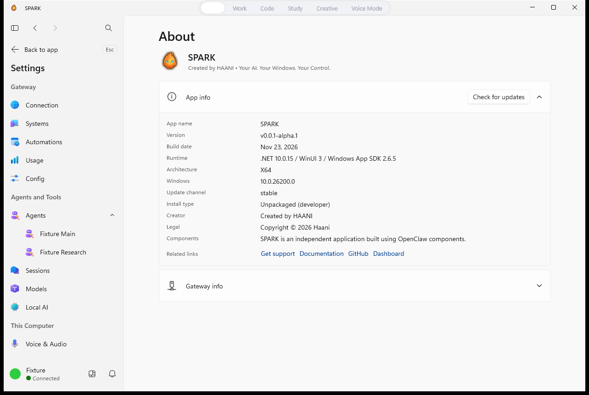
</p>

### Option B: Building from Source

#### 1. Prerequisites for Developers
- [.NET 10.0 SDK](https://dotnet.microsoft.com/download/dotnet/10.0) (`10.0.400` or higher).
- [Node.js v26 LTS](https://nodejs.org/) and `pnpm`.
- [Inno Setup 6](https://jrsoftware.org/isdl.php) (if compiling the Windows installer).
- [Python 3.10+](https://www.python.org/) (for developing Voice Mode).

#### 2. Clone the Repository
```powershell
git clone https://github.com/haanifaad/Spark.git
cd Spark\Spark-main
```

#### 3. Restore Dependencies and Build
```powershell
# Build entire solution in Release configuration
dotnet build SPARK.sln -c Release
```

#### 4. Run Test Suites
```powershell
# Run all unit and integration test suites
dotnet test tests\OpenClaw.Shared.Tests\OpenClaw.Shared.Tests.csproj
dotnet test tests\OpenClaw.Connection.Tests\OpenClaw.Connection.Tests.csproj
```

#### 5. Compile the Standalone Installer
```powershell
# Automatically builds, packages, and signs the Inno Setup installer
powershell -ExecutionPolicy Bypass -File .\scripts\build-inno-local.ps1 -Arch x64 -Fast
```
The resulting installer will be output directly to `C:\Users\PC\Documents\Spark\Output\SPARK-Setup.exe`.

---

## 17. Configuration and Environment Variables

SPARK stores user settings securely in `%LOCALAPPDATA%\OpenClawTray\config\settings.json`. Sensitive API keys are protected using **Windows DPAPI (Data Protection API)** encryption.

### Supported Environment Variables
You can optionally configure environment variables globally or within a local `.env` file:

```ini
# Gateway Connection
OPENCLAW_GATEWAY_PORT=18789
OPENCLAW_GATEWAY_HOST=127.0.0.1

# Cloud AI Provider API Keys
ANTHROPIC_API_KEY="sk-ant-..."
OPENAI_API_KEY="sk-proj-..."
GEMINI_API_KEY="AIzaSy..."
GROQ_API_KEY="gsk_..."
ELEVENLABS_API_KEY="..."

# Local Inference Configuration
SPARK_LOCAL_AI_PORT=18803
SPARK_LOCAL_AI_MODELS_PATH="C:\Users\PC\.spark\models"

# Voice Mode Settings
SPARK_VOICE_ENGINE="EdgeTTS"      # Options: EdgeTTS, Kokoro, ElevenLabs
SPARK_VOICE_STT="faster-whisper"  # Options: faster-whisper, Sherpa-ONNX
```

---

## 18. Running SPARK

### Starting the Application
- **Direct Launch**: Launch `OpenClawTray.exe` from Start Menu or desktop shortcut.
- **Protocol Activation**: Trigger SPARK from any browser or terminal via:
  ```powershell
  start openclaw://open
  start openclaw://chat
  start openclaw://settings
  ```
- **System Tray Mode**: When minimized, SPARK resides in the Windows notification area. Right-click the tray icon for instant actions or click to open the quick flyout.

---

## 19. Development Workflow

### Solution Projects Overview
- `OpenClaw.Tray.WinUI`: Main entry executable. WinUI 3 desktop client and views.
- `OpenClaw.Shared`: Cross-cutting models, local inference supervisors, and Sentinel approvals.
- `OpenClaw.Connection`: High-speed WebSocket client and JSON-RPC dispatchers.
- `OpenClaw.Chat`: Custom Markdown parsers and chat bubble visual controls.
- `OpenClaw.SetupEngine`: Diagnostic hardware checks and prerequisite detection.

### Code Style & Guidelines
- Strict adherence to C# 13 nullable reference types (`<Nullable>enable</Nullable>`).
- MVVM design pattern with `CommunityToolkit.Mvvm` (`[ObservableProperty]`, `[RelayCommand]`).
- UI thread dispatching via `DispatcherQueue.TryEnqueue` for all asynchronous background events.

---

## 20. API and Backend Architecture

SPARK coordinates multiple internal loopback endpoints:

1. **Gateway WebSocket RPC (`ws://127.0.0.1:18789`)**:
   - Cryptographically authenticated via Ed25519 device keys.
   - Handles real-time chat streaming, session synchronization, and tool call dispatching.
2. **Local Inference API (`http://127.0.0.1:18803/v1`)**:
   - Implements standard OpenAI-compatible endpoints (`/v1/chat/completions`, `/v1/models`).
   - Serviced directly by `llama-server`.
3. **Model Context Protocol (MCP) Bridge (`http://127.0.0.1:18793`)**:
   - Exposes local file system, command line, and computer tools to standard MCP clients.
4. **Voice Daemon IPC**:
   - Bi-directional standard I/O (stdin/stdout) JSON communication for low-latency state synchronization between C# WinUI 3 and Python PyQt/OpenGL.

---

## 21. Security and Privacy

<p align="center">
  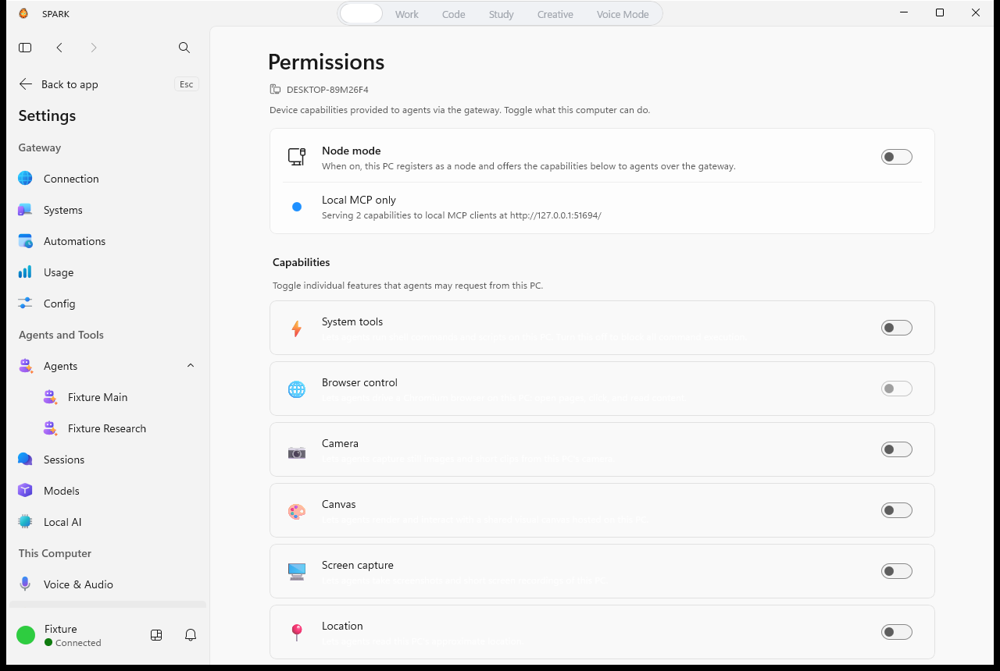
</p>

- **Sentinel Human-in-the-Loop Approvals**: High-impact agent mutations (deleting files, executing shell commands, sending external emails) require explicit interactive user approval.
- **Process Isolation**: All background processes execute inside Win32 Job Objects; no orphaned workers or zombie processes can persist after application exit.
- **Local Loopback Binding**: All Gateway and server sockets bind exclusively to `127.0.0.1` (loopback), preventing unauthorized local network exposure.
- **DPAPI Credential Storage**: All cloud API keys and secret tokens are encrypted on disk using the current Windows user's DPAPI master key.
- **SSRF & Sandbox Boundaries**: Outbound tool requests are strictly filtered to prevent Server-Side Request Forgery against internal infrastructure.

---

## 22. Screenshots and Visual Documentation

| Category | Screen | Description | Preview |
|---|---|---|:---:|
| **Workspace** | **SPARK Shell Overview** | Unified title bar, division switcher, and dual-pane chat. | [View Screenshot](docs/screenshots/00-Overview/spark-workspace-overview.png) |
| **Work Division** | **Autonomous Personal Agent** | Multi-step task planner, proactive background routine scheduler. | [View Screenshot](docs/screenshots/01-Dashboard/work-division-autonomous-agent.png) |
| **Work Division** | **Tools & MCP Registry** | Registered capabilities, tool execution permissions, invocation counters. | [View Screenshot](docs/screenshots/02-AI-Core/work-division-tools-mcp-registry.png) |
| **Chat Division** | **Main Chat Interface** | Streaming responses, token metrics, and model selectors. | [View Screenshot](docs/screenshots/03-Chat/chat-main.png) |
| **Voice Mode** | **Voice & Audio Settings** | STT/TTS engine selection, audio device setup, speech volume. | [View Screenshot](docs/screenshots/04-Voice/voice-settings-audio.png) |
| **Memory** | **Memory Store Ledger** | Persistent SQLite vector store, learned user facts, and memory search. | [View Screenshot](docs/screenshots/06-Memory/work-division-memory-store.png) |
| **Productivity** | **Code Division IDE Shell** | Tabbed code viewer, repository file explorer, and terminal console. | [View Screenshot](docs/screenshots/09-Productivity/code-division-main.png) |
| **Productivity** | **Creative Division Studio** | 16-app creative studio suite (VectorSpark, WordSpark, FilmSpark, etc.). | [View Screenshot](docs/screenshots/09-Productivity/creative-division-studio.png) |
| **Automation** | **Cron & Interval Schedules** | Automated background job definitions and routine scheduler. | [View Screenshot](docs/screenshots/10-Automation/automations-cron-schedules.png) |
| **Automation** | **Computer Use Automation** | UI-TARS 1000 coordinate grounding and desktop screen perception. | [View Screenshot](docs/screenshots/10-Automation/computer-use-automation.png) |
| **Security** | **Permissions & Capabilities** | Granular toggles for file system, camera, screen, and terminal access. | [View Screenshot](docs/screenshots/14-Security/permissions-capabilities.png) |
| **Security** | **Approvals & Forensic Audit** | Human-in-the-loop pending approval requests and tamper-evident audit logs. | [View Screenshot](docs/screenshots/14-Security/work-division-approvals-audit.png) |
| **Diagnostics** | **System & Node Management** | Real-time diagnostic exporter, internal event traces, and RPC monitor. | [View Screenshot](docs/screenshots/15-System-Management/diagnostics-debug-page.png) |

---

## 23. Current Development Status

The following matrix documents the verification status across SPARK's architecture:

| Component / Subsystem | Implementation Status | Notes |
|---|---|---|
| **WinUI 3 Fluent Client Shell** | `[Fully Implemented]` | Native .NET 10 desktop client with Mica backdrop, Division Switcher, and dark/light themes. |
| **Chat Division** | `[Fully Implemented]` | Streaming markdown chat, reasoning picker, session branching, and copy actions. |
| **Work Division (Personal Agent)** | `[Fully Implemented]` | Goal planner, autonomous worker deck, MCP registry, and Team Rooms. |
| **Code Division Shell & Console** | `[Fully Implemented]` | File explorer, multi-tab code editor, interactive Win32 terminal console. |
| **Study Division Workspace** | `[Partially Implemented]` | Core concept breakdown and research synthesis active; flashcard exporter in progress. |
| **Creative Division (16 Studio Apps)** | `[Fully Implemented]` | Full 16-app gallery, VectorSpark Bézier editor, WordSpark, and asset pipelines. |
| **Local Inference (`llama-server`)** | `[Fully Implemented]` | Managed loopback supervisor (:18803), GGUF loader, hardware CUDA probes. |
| **Cloud Model Providers** | `[Fully Implemented]` | Claude, OpenAI, Gemini, Groq, Mistral, and custom OpenAI endpoints. |
| **Voice Mode (Mark-LVII HUD)** | `[Fully Implemented]` | Arc Reactor visualizer, 3D face mesh, EdgeTTS, Kokoro, faster-whisper, Malayalam STT. |
| **Computer Use (UI-TARS Grounding)** | `[Fully Implemented]` | 1000-normalized coordinates, Win32 input injection, GDI+ screen perception. |
| **Sentinel Approval Manager** | `[Fully Implemented]` | Reactive UI approval notifications, permission persistence, tamper-evident logs. |
| **Cron & Background Automation** | `[Fully Implemented]` | Standard 5-field cron parsing, interval scheduling, proactive routines. |
| **Structured Memory Journal** | `[Fully Implemented]` | SQLite WAL database, topic memory extraction, division segregation. |
| **Inno Setup Windows Installer** | `[Fully Implemented]` | Tested standalone installer generating `SPARK-Setup.exe` with zero errors. |
| **Gemini Live Bidirectional Streaming** | `[In Development]` | WebSocket audio streaming functional; multi-turn latency optimization ongoing. |
| **Multi-Modal Vision Agent Refinement** | `[In Development]` | Real-time desktop streaming video perception undergoing performance tuning. |
| **Mobile Companion Application** | `[Planned]` | Remote monitoring of autonomous agent progress via mobile client. |

---

## 24. Known Limitations

1. **Windows Platform Exclusive**: Designed specifically for Windows 11 and Windows 10 x64. ARM64 compilation is supported via `-Arch arm64`, but macOS and Linux are not currently supported.
2. **Local LLM Performance Hardware Bound**: Running large language models (e.g., 14B or 70B parameter models) locally requires an NVIDIA GPU with at least 8 GB to 16 GB of VRAM. Older GPUs without modern CUDA support fall back to CPU AVX2 execution.
3. **Voice Mode Python Dependencies**: Full Mark-LVII Voice Mode requires a Python 3.10+ runtime with PyQt6 and audio libraries.

---

## 25. Future Development Roadmap

- [ ] **Decentralized Agent Synchronization**: Secure peer-to-peer syncing of memory journals across multiple personal Windows devices.
- [ ] **Multi-Screen Vision Perception**: Enhanced simultaneous multi-monitor perception with real-time semantic segmentation.
- [ ] **Extended Creative Studio Exports**: Direct rendering of 4K video exports from FilmSpark using hardware NVENC acceleration.
- [ ] **Mobile Companion Relay**: Companion notification app for reviewing agent approval requests on iOS and Android.

---

## 26. Contributors

SPARK is developed, maintained, and actively advanced by:

- **Haani Faad** — *Project Lead & Principal Software Architect*
- **Simin Ajmal** — *Project Contributor & AI Systems Engineer*
- **Muhammed Yaseen** — *Project Contributor & Full-Stack Engineer*
- **Najid** — *Project Contributor & QA / Testing Specialist*

---

## 27. License

This project is licensed under the **MIT License** — see the [LICENSE](LICENSE) file for details.

### Upstream Attribution & Open-Source Acknowledgments
SPARK incorporates and adapts open-source architectural patterns from the **OpenClaw** project and **OpenClaw Windows Node** (`openclaw-windows-node`), published under the MIT License by the OpenClaw Foundation and its community contributors. All upstream copyrights, trademarks, and open-source license notices have been preserved in accordance with the MIT License.

See [docs/release/dependency-audit.md](docs/release/dependency-audit.md) and [Documentation/SECURITY_AUDIT.md](Documentation/SECURITY_AUDIT.md) for complete dependency licenses and audit attestations.

---

<p align="center">
  <strong>SPARK</strong> — <em>Empowering personal intelligence on Windows.</em>
</p>
