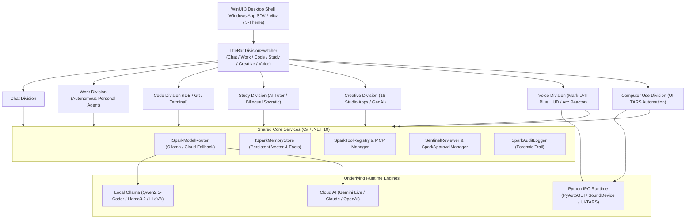

# SPARK — Master Architecture Specification
**Document Date:** November 23, 2026  
**Architect:** Principal Software Architect & AI Systems Engineer  
**Target:** `C:\Users\PC\Documents\Spark\Spark-main`

---

## 1. System Architecture Overview

SPARK is designed as a unified, native Windows AI workstation combining the responsiveness of .NET 10 / WinUI 3 with local & cloud AI inference, autonomous agent orchestration, computer use automation, and specialized workspace divisions.

---

## 2. Core Architectural Pillars

### 2.1 Unified Shared Infrastructure
All divisions communicate through centralized, thread-safe contracts:
- **`ISparkModelRouter`:** Capability-based routing across local Ollama instances and external cloud providers with circuit breaker failovers.
- **`ISparkMemoryStore`:** Cross-division SQLite long-term memory for user facts, preferences, and workspace context.
- **`ISentinelReviewer` & `ISparkApprovalManager`:** Security gate requiring human authorization for high-risk actions (purchases, emails, external mutations).
- **`ISparkAuditLogger`:** Tamper-evident forensic audit log capturing every action, tool execution, and prompt.

### 2.2 Scoped HUD Isolation
The high-tech Mark-LVII Blue HUD (`#00060A`, `#00D4FF`) is strictly encapsulated within `VoiceModePage.xaml`. When the user switches to Chat, Work, Code, Study, or Creative, the shell seamlessly returns to the standard Windows 11 Fluent Theme (Light, Night, or System).
