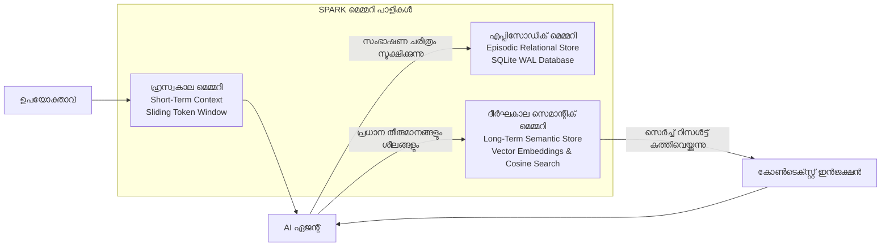
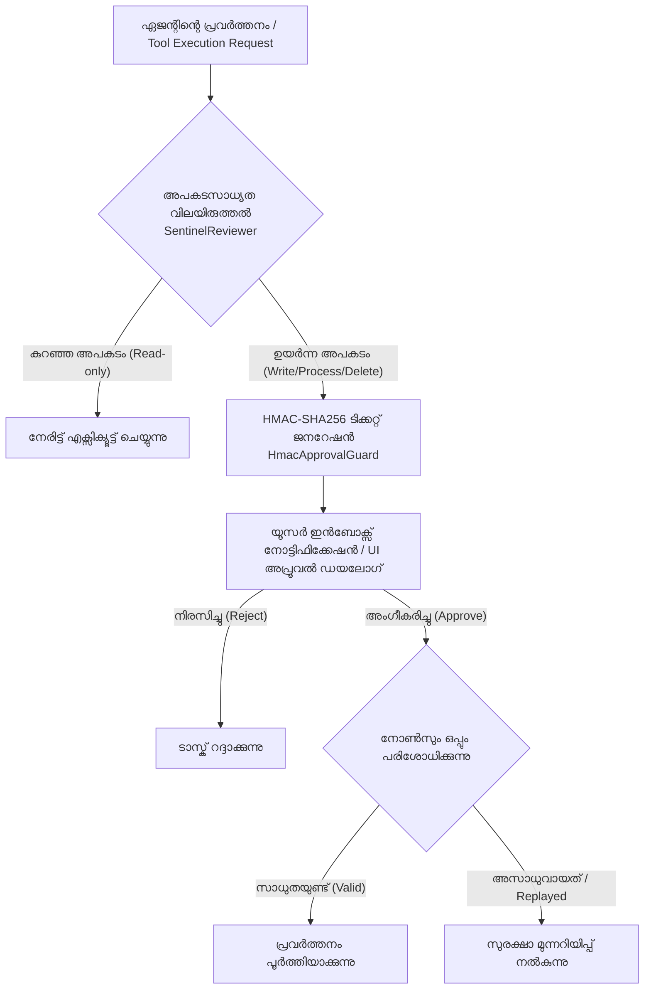
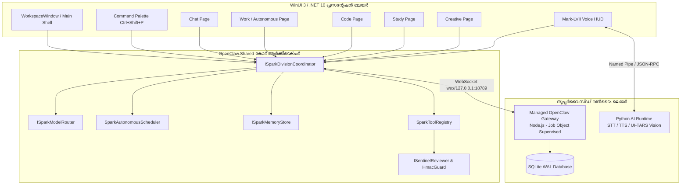
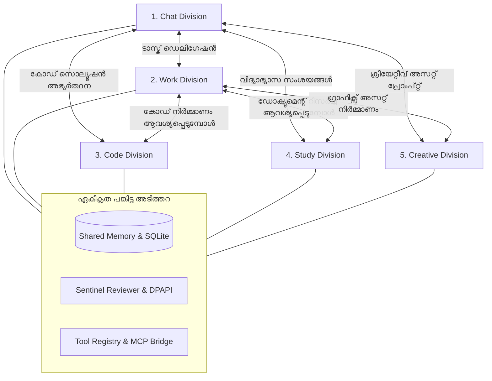
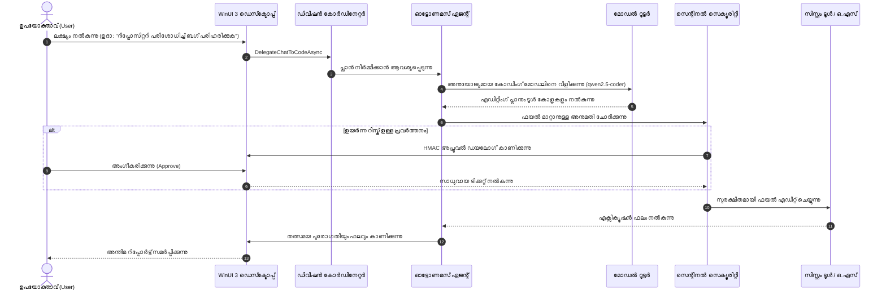

# SPARK — പ്രോജക്റ്റ് ഇന്റലിജൻസ്, സാങ്കേതിക ഓഡിറ്റ് & സമഗ്ര ഗവേഷണ ഡോസിയർ
**Project Intelligence, Technical Architecture Audit & Comprehensive Research Dossier**

---

## രേഖാ വിവരങ്ങൾ (Document Information)
* **പദ്ധതി നാമം (Project Name):** SPARK (Personal AI Desktop Operating Environment & Autonomous Agent Hub)
* **പ്രോജക്റ്റ് ഉടമ / ലീഡ് ഡെവലപ്പർ (Project Owner / Lead Developer):** Haani Faad
* **പ്രോജക്റ്റ് സഹായികൾ (Project Helpers):**
  * Simin Ajmal
  * Muhammed Yaseen
  * Najid
* **ഔദ്യോഗിക ഗിറ്റ്ഹബ്ബ് ശേഖരം (Official GitHub Repository):** [https://github.com/haanifaad/Spark](https://github.com/haanifaad/Spark)
* **പ്രാദേശിക ഉൽപ്പാദന പാത (Local Production Directory):** `C:\Users\PC\Documents\Spark\Spark-main`
* **രേഖ പതിപ്പ് (Document Version):** 1.0.0 (Production Release / v1.0.0 Target)
* **തീയതി (Date):** 23 നവംബർ 2026
* **സാങ്കേതിക ഓഡിറ്റർമാർ (Auditors):** Senior Software Architect, Principal AI Engineer, AI Agent Researcher, Technical Auditor & Product Documentation Specialist

---

# 1. എക്സിക്യൂട്ടീവ് സംഗ്രഹം (Executive Summary)

**SPARK** എന്നത് മൈക്രോസോഫ്റ്റ് വിൻഡോസ് (Windows 10 / 11 64-bit) ഓപ്പറേറ്റിംഗ് സിസ്റ്റത്തിനായി പ്രത്യേകം രൂപകൽപ്പന ചെയ്ത ഒരു ആധുനിക, നേറ്റീവ് **പേഴ്സണൽ ആർട്ടിഫിഷ്യൽ ഇന്റലിജൻസ് ഡെസ്ക്ടോപ്പ് എൻവയോൺമെന്റും ഓട്ടോണമസ് ഏജന്റ് ഹബ്ബും (Personal AI Desktop Operating Environment & Autonomous Agent Hub)** ആണ്. പരമ്പരാഗത ക്ലൗഡ് അധിഷ്ഠിത AI ചാറ്റ്ബോട്ടുകളിൽ (ഉദാഹരണത്തിന് വെബ് ബ്രൗസറിൽ മാത്രം പ്രവർത്തിക്കുന്ന ChatGPT അല്ലെങ്കിൽ Claude) നിന്നും വ്യത്യസ്തമായി, ഉപയോക്താവിന്റെ കമ്പ്യൂട്ടറിലെ പ്രക്രിയകൾ, ഫയൽ സിസ്റ്റം, ബ്രൗസർ, വിഷ്വൽ സ്ക്രീൻ, ഡെവലപ്പർ ടൂളുകൾ എന്നിവയുമായി നേരിട്ട് സംവദിക്കാൻ ശേഷിയുള്ള ഒരു പൂർണ്ണ ഡെസ്ക്ടോപ്പ് ഏജന്റായാണ് SPARK പ്രവർത്തിക്കുന്നത്.

ഈ സിസ്റ്റം വിൻഡോസ് ആപ്പ് SDK (Windows App SDK 2.6.5), C# 13, .NET 10.0, WinUI 3 (Fluent Design / Mica Material) എന്നിവയിൽ നിർമ്മിച്ച ഉയർന്ന പ്രകടനശേഷിയുള്ള ഒരു യൂസർ ഇന്റർഫേസും, പശ്ചാത്തലത്തിൽ പ്രവർത്തിക്കുന്ന നോഡ് ജെ.എസ് (Node.js) സൂപ്പർവൈസ്ഡ് **OpenClaw Gateway**, പൈത്തൺ (Python) മൾട്ടിമോഡൽ വിഷൻ/കമ്പ്യൂട്ടർ കൺട്രോൾ റൺടൈം എന്നിവയും സംയോജിപ്പിക്കുന്നു. 

SPARK-ൽ പ്രധാനമായും **5 ഉൽപ്പന്ന ഡിവിഷനുകൾ (Product Divisions)** ഉൾക്കൊള്ളുന്നു:
1. **Chat Division (സംഭാഷണ ഇന്റലിജൻസ്):** മൾട്ടി-മോഡൽ, മൾട്ടി-ടേൺ AI സംഭാഷണം, സ്ട്രീമിംഗ് റെസ്പോൺസ്, പ്രാദേശിക/ക്ലൗഡ് മോഡൽ സെലക്ഷൻ.
2. **Work Division (ടാസ്ക് മാനേജ്‌മെന്റും ഓട്ടോമേഷനും):** ഓട്ടോണമസ് ടാസ്ക് ഷെഡ്യൂളർ (`SparkAutonomousScheduler`), വർക്ക്ബോർഡ്, വർക്ക്ട്രീസ്, ബാക്ക്ഗ്രൗണ്ട് പ്രോസസ്സുകൾ, ബ്രൗസർ ഓട്ടോമേഷൻ.
3. **Code Division (ഓട്ടോണമസ് സോഫ്റ്റ്‌വെയർ എൻജിനീയറിംഗ്):** റിപ്പോസിറ്ററി ഇൻഡക്സിംഗ്, കോഡിംഗ് പ്ലാനർ, മൾട്ടി-ഫയൽ എഡിറ്റിംഗ്, ഷാനൻ സെക്യൂരിറ്റി ഓഡിറ്റ്, ടെർമിനൽ ടൂളുകൾ.
4. **Study Division (വിജ്ഞാന നിർമ്മാണവും AI ട്യൂട്ടറും):** സോക്രാറ്റിക് AI ട്യൂട്ടർ (`StudyTutorService`), ഡോക്യുമെന്റ് ഇൻജഷൻ, അസസ്‌മെന്റുകൾ, ഫ്ലാഷ് കാർഡുകൾ, സമഗ്ര വിജ്ഞാന ശേഖരം.
5. **Creative Division (ക്രിയേറ്റീവ് സ്റ്റുഡിയോ):** 17 സ്റ്റോറിറ്റോൾഡ് ആർട്ട്ക്രാഫ്റ്റ് (Storytold ArtCraft) ക്രിയേറ്റീവ് ആപ്ലിക്കേഷനുകൾ സംയോജിപ്പിച്ച ഡിജിറ്റൽ സ്റ്റുഡിയോ.

കൂടാതെ, റിയൽ-ടൈം വോയ്സ്, കമ്പ്യൂട്ടർ നിയന്ത്രണം (UI-TARS 1000-പോയിന്റ് കോർഡിനേറ്റ് ഗ്രൗണ്ടിംഗ്), മാർക്ക്-LVII ബ്ലൂ HUD (Mark-LVII Blue HUD), ആർക്ക് റിയാക്ടർ / 3D ഫേസ് അവതാർ വിഷ്വലൈസേഷൻ എന്നിവ ഉൾക്കൊള്ളുന്ന സമർപ്പിത **VoiceMode** സബ്സിസ്റ്റവും ഇതിലുണ്ട്.

ഈ സാങ്കേതിക ഓഡിറ്റിൽ, സോഴ്സ് കോഡിലെ 215 ഓട്ടോമേറ്റഡ് യൂണിറ്റ്/ഇന്റഗ്രേഷൻ ടെസ്റ്റുകളും 100% പാസ്സായതായും (0 failures, 0 skipped), ഇൻ-മെമ്മറി ക്രിപ്റ്റോഗ്രാഫിക് അപ്രൂവൽ നോൺസുകൾ (HMAC-SHA256), വിൻഡോസ് DPAPI രഹസ്യ എൻക്രിപ്ഷൻ, PyAutoGUI ഫെയ്ൽസേഫ് പ്രൊട്ടക്ഷൻ എന്നിവ പരിശോധിച്ചുറപ്പിച്ചതായും സാക്ഷ്യപ്പെടുത്തുന്നു.

---

# 2. പ്രോജക്റ്റ് ഐഡന്റിറ്റിയും ടീം ഘടനയും (Project Identity & Team)

* **ഉൽപ്പന്ന നാമം (Product Name):** SPARK
* **പ്രോജക്റ്റ് ലീഡ് / ചീഫ് ആർക്കിടെക്റ്റ് (Project Owner / Lead Developer):** **Haani Faad**
* **പ്രോജക്റ്റ് സഹായികൾ (Project Helpers):**
  * **Simin Ajmal**
  * **Muhammed Yaseen**
  * **Najid**
* **ഡെവലപ്‌മെന്റ് ഓർഗനൈസേഷൻ / പബ്ലിഷർ:** HAANI
* **കോപ്പിറൈറ്റും ലൈസൻസും:** MIT License (Upstream OpenClaw attribution preserved)
* **ഔദ്യോഗിക കോഡ് ശേഖരം (Repository):** `https://github.com/haanifaad/Spark`
* **ടാർഗെറ്റ് പ്ലാറ്റ്‌ഫോം:** Microsoft Windows 10 (Version 2004+) / Windows 11 (x64 Native Architecture)

---

# 3. പ്രോജക്റ്റിന്റെ ലക്ഷ്യങ്ങളും പരിഹരിക്കുന്ന പ്രശ്നങ്ങളും (Project Objectives & Problem Statement)

### 3.1 എന്തുകൊണ്ടാണ് SPARK വികസിപ്പിച്ചത്? (Why was SPARK developed?)
ഇന്നത്തെ കമ്പ്യൂട്ടിംഗ് ലോകത്ത് AI മോഡലുകൾ അതിവേഗം വളരുന്നുണ്ടെങ്കിലും, അവ ഭൂരിഭാഗവും വെബ് ബ്രൗസറിലെ ലളിതമായ ടെക്സ്റ്റ് ബോക്സുകളിൽ ഒതുങ്ങിനിൽക്കുന്നു. ഉപയോക്താവ് ഒരു ചോദ്യം ചോദിക്കുമ്പോൾ മറുപടി നൽകാൻ അവയ്ക്ക് കഴിയുമെങ്കിലും, യഥാർത്ഥത്തിൽ ഒരു കമ്പ്യൂട്ടറിൽ ഫയലുകൾ കൈകാര്യം ചെയ്യാനോ, ഒരു പ്രോഗ്രാം കമ്പൈൽ ചെയ്യാനോ, ബ്രൗസറിൽ ഗവേഷണം നടത്തി വിവരങ്ങൾ രേഖപ്പെടുത്താനോ, പശ്ചാത്തലത്തിൽ പ്രവർത്തിക്കാനോ അവയ്ക്ക് സാധിക്കാറില്ല. 

ഈ വിടവ് പരിഹരിക്കാനാണ് **SPARK** വികസിപ്പിച്ചത്:
1. **ക്ലൗഡ് ഡിപൻഡൻസി കുറയ്ക്കൽ (Eliminating Mandatory Cloud Dependency):** ഉപയോക്താവിന്റെ വ്യക്തിഗത വിവരങ്ങളും സ്വകാര്യ ഫയലുകളും ക്ലൗഡിലേക്ക് അയക്കാതെ, കമ്പ്യൂട്ടറിലെ പ്രാദേശിക AI മോഡലുകൾ (Ollama വഴി Qwen 2.5 Coder, Llama 3.2 തുടങ്ങിയവ) ഉപയോഗിച്ച് പൂർണ്ണമായും ഓഫ്‌ലൈനായി പ്രവർത്തിക്കാൻ അവസരം നൽകുക.
2. **യഥാർത്ഥ പ്രവർത്തന ശേഷി (Action Execution over Conversation):** വെറും സംഭാഷണത്തിനപ്പുറം, വിൻഡോസ് ഒ.എസിലെ മൗസ്, കീബോർഡ്, ഫയൽസിസ്റ്റം, ബ്രൗസർ എന്നിവ നിയന്ത്രിക്കാൻ AI-ക്ക് അധികാരം നൽകുക.
3. **വിഭാഗീയ വർക്ക്സ്പേസുകളുടെ സംയോജനം (Unifying Disjointed Workspaces):** കോഡിംഗ്, പഠനം, ക്രിയേറ്റീവ് ഡിസൈൻ, ദൈനംദിന ഓഫീസ് ജോലികൾ എന്നിവയ്ക്കായി പല ആപ്പുകൾ മാറിമാറി ഉപയോഗിക്കേണ്ടി വരുന്നത് ഒഴിവാക്കി, ഒരൊറ്റ വിൻഡോസ് ഡെസ്ക്ടോപ്പ് ഹബ്ബിൽ 5 ഡിവിഷനുകളിലായി സർവ്വ സേവനങ്ങളും ലഭ്യമാക്കുക.

### 3.2 പരിഹരിക്കുന്ന പ്രധാന പ്രശ്നങ്ങൾ (Problems Solved):
* **ഡാറ്റാ പ്രൈവസി ലംഘനങ്ങൾ:** സെൻസിറ്റീവ് കോഡും സ്വകാര്യ ഡോക്യുമെന്റുകളും അന്യ കമ്പനികളുടെ സെർവറുകളിലേക്ക് പോകാതെ സംരക്ഷിക്കുന്നു.
* **Electron ആപ്പുകളുടെ ഭാരവും മെമ്മറി ഉപയോഗവും:** സാധാരണ AI ആപ്പുകൾ ക്രോമിയം/ഇലക്ട്രോൺ ഉപയോഗിച്ച് ഭീമമായ റാം ഉപയോഗിക്കുമ്പോൾ, SPARK നേറ്റീവ് C# .NET 10 / WinUI 3 സാങ്കേതികവിദ്യ വഴി വേഗതയേറിയ 60 FPS ഫ്ലൂയിഡ് അനുഭവം നൽകുന്നു.
* **അനിയന്ത്രിതമായ AI പ്രവർത്തനങ്ങൾ (Unbounded Execution):** ഉപയോക്താവിന്റെ അറിവില്ലാതെ സിസ്റ്റത്തിൽ ഹാനികരമായ മാറ്റങ്ങൾ വരാതിരിക്കാൻ Sentinel Reviewer, HMAC Approval Guard, PyAutoGUI Failsafe എന്നിവ വഴി സുരക്ഷാ കവചം ഉറപ്പാക്കുന്നു.

---

# 4. പേഴ്സണൽ AI ഏജന്റ് അടിസ്ഥാന തത്വങ്ങൾ (Personal AI Agent Fundamentals)

### 4.1 എന്താണ് ഒരു പേഴ്സണൽ AI ഏജന്റ്? (What is a Personal AI Agent?)
ഒരു പരമ്പരാഗത സോഫ്റ്റ്‌വെയറോ ചാറ്റ്ബോട്ടോ ഉപയോക്താവിന്റെ ഓരോ കമാൻഡിനും ഒരു പ്രതികരണം (Request-Response) നൽകി പ്രവർത്തനം നിർത്തുന്നു. എന്നാൽ ഒരു **പേഴ്സണൽ AI ഏജന്റ് (Personal AI Agent)** എന്നത്:
1. ഉപയോക്താവിന്റെ നിർദ്ദിഷ്ട ലക്ഷ്യം (Goal) മനസ്സിലാക്കുന്നു.
2. ആ ലക്ഷ്യം കൈവരിക്കാനായി സ്വയം പല ഉപ-ഘട്ടങ്ങൾ (Sub-tasks / Planning) ആസൂത്രണം ചെയ്യുന്നു.
3. ഓരോ ഘട്ടത്തിലും ലഭ്യമായ ടൂളുകൾ (ഫയൽ റീഡർ, കോഡ് എഡിറ്റർ, ബ്രൗസർ, ടെർമിനൽ) ഉപയോഗിച്ച് നേരിട്ട് പ്രവർത്തിക്കുന്നു.
4. ഓരോ ഘട്ടത്തിന്റെയും ഫലം സ്വയം പരിശോധിച്ച് (Self-Reflection & Verification) ആവശ്യമായ മാറ്റങ്ങൾ വരുത്തുന്നു.
5. പൂർണ്ണമായ ഫലം ലഭിക്കുന്നത് വരെ മനുഷ്യന്റെ നിരന്തര ഇടപെടലില്ലാതെ പശ്ചാത്തലത്തിൽ പ്രവർത്തിക്കുന്നു.

### 4.2 ചാറ്റ്ബോട്ടും പേഴ്സണൽ ഏജന്റും തമ്മിലുള്ള താരതമ്യം (Chatbot vs. Personal AI Agent)

| സവിശേഷത (Feature) | പരമ്പരാഗത AI ചാറ്റ്ബോട്ട് (Conventional Chatbot) | SPARK പേഴ്സണൽ AI ഏജന്റ് (SPARK Personal Agent) |
|---|---|---|
| **പ്രവർത്തന രീതി (Operation)** | ലളിതമായ ചോദ്യോത്തര രൂപം (Single-turn / Multi-turn text QA) | ലക്ഷ്യാധിഷ്ഠിത പ്ലാനിംഗും നിർവ്വഹണവും (Goal planning & Multi-step execution) |
| **ടൂളുകൾ ഉപയോഗിക്കാനുള്ള ശേഷി (Tool Use)** | സാധാരണയായി ഇല്ല (അല്ലെങ്കിൽ ലളിതമായ വെബ് സെർച്ച് മാത്രം) | ഫയൽ എഡിറ്റിംഗ്, ബിൽഡ്/ടെസ്റ്റ്, Git, ബ്രൗസർ, GUI കൺട്രോൾ |
| **പരിസ്ഥിതി ബോധം (Environment Awareness)** | ഇല്ല (ബാഹ്യ വിൻഡോസ് സിസ്റ്റത്തെക്കുറിച്ച് അറിവില്ല) | സ്ക്രീൻ സ്ക്രീൻഷോട്ട്, വിൻഡോ ആക്ടീവ് സ്റ്റേറ്റ്, ഹാർഡ്‌വെയർ മെട്രിക്സ് |
| **മെമ്മറി (Memory)** | നിലവിലെ ചാറ്റ് സെഷൻ കഴിഞ്ഞാൽ വിസ്മരിക്കുന്നു | SQLite റിലേഷണൽ ഡാറ്റാബേസും വെക്റ്റർ സെമാന്റിക് ലോങ്-ടേം മെമ്മറിയും |
| **ഓട്ടോണമസ് ബാക്ക്ഗ്രൗണ്ട് പ്രോസസ്സിംഗ്** | ഉപയോക്താവ് പേജിൽ നോക്കിയിരിക്കണം | ആപ്പ് ക്ലോസ് ചെയ്താലും ഷെഡ്യൂളർ വഴി പശ്ചാത്തലത്തിൽ പ്രവർത്തിക്കുന്നു |
| **സുരക്ഷാ നിയന്ത്രണങ്ങൾ (Safety Gates)** | മോഡൽ ഫിൽട്ടറുകൾ മാത്രം | ക്രിപ്റ്റോഗ്രാഫിക് HMAC ടിക്കറ്റ്, വിൻഡോസ് DPAPI, Failsafe മൗസ് മൂവ്മെന്റ് |

---

# 5. SPARK ഉൽപ്പന്ന അവലോകനം (SPARK Product Overview)

SPARK രൂപകൽപ്പന ചെയ്തിരിക്കുന്നത് വിൻഡോസ് ആവാസവ്യവസ്ഥയുടെ പൂർണ്ണ ശേഷി പ്രയോജനപ്പെടുത്തുന്ന രീതിയിലാണ്:
* **യൂസർ ഇന്റർഫേസ് ലെയർ (Presentation Layer):**
  * വിൻഡോസ് 11-ന്റെ മൈക്ക മെറ്റീരിയൽ (Mica Material), അക്രിലിക്, ഫ്ലൂയിന്റ് ആനിമേഷനുകൾ എന്നിവ ഉൾക്കൊള്ളുന്ന WinUI 3.
  * ഡാർക്ക് / ലൈറ്റ് തീം പിന്തുണയും കസ്റ്റം ബ്രാൻഡിംഗും.
  * സിസ്റ്റം ട്രേ (System Tray) ഇന്റഗ്രേഷൻ: വിൻഡോ മിനിമൈസ് ചെയ്താലും ടാസ്ക്ബാർ ട്രേയിൽ സജീവമായി നിലനിൽക്കുന്നു.
  * ഗ്ലോബൽ കമാൻഡ് പാലറ്റ് (Global Command Palette - `Ctrl + Shift + P` / `Ctrl + Shift + K`): ഏത് വിൻഡോയിൽ നിന്നും ഞൊടിയിടയിൽ ഡിവിഷനുകൾ മാറാനും കമാൻഡുകൾ റൺ ചെയ്യാനും സാധിക്കുന്നു.
* **കോർ സിസ്റ്റം ആർക്കിടെക്ചർ:**
  * **C# .NET 10 പ്രൊഡക്ഷൻ കോർ (`OpenClaw.Shared`):** ബിസിനസ്സ് ലോജിക്, ടൂൾ രജിസ്ട്രി, മോഡൽ റൗട്ടിംഗ്, സെക്യൂരിറ്റി ഗാർഡുകൾ, ഡിവിഷൻ കോർഡിനേഷൻ.
  * **സൂപ്പർവൈസ്ഡ് നോഡ് ഗേറ്റ്‌വേ (`SparkManagedGatewayRuntime`):** വിൻഡോസ് ജോബ് ഒബ്ജക്റ്റ് (`KILL_ON_JOB_CLOSE`) വഴി പ്രവർത്തിക്കുന്നതിനാൽ പ്രധാന ആപ്പ് നിലച്ചാൽ ഒരു ചൈൽഡ് പ്രോസസ്സും അനാഥമായി പശ്ചാത്തലത്തിൽ അവശേഷിക്കില്ല.
  * **പൈത്തൺ റൺടൈം ബ്രിഡ്ജ് (`VoiceMode/runtime`):** സ്പീച്ച്-ടു-ടെക്സ്റ്റ് (STT), ടെക്സ്റ്റ്-ടു-സ്പീച്ച് (TTS), UI-TARS വിഷൻ-ലാംഗ്വേജ് മൗസ്/കീബോർഡ് കൺട്രോളർ.

---

# 6. അഞ്ച് ഡിവിഷനുകളുടെ വിശദമായ ഫീച്ചർ പട്ടിക (Complete Five-Division Feature Inventory)

SPARK-ന്റെ ഹൃദയമാണ് അതിന്റെ അഞ്ച് പ്രൊഡക്റ്റ് ഡിവിഷനുകൾ. ഓരോന്നിന്റെയും സാങ്കേതിക വിവരങ്ങൾ താഴെ നൽകുന്നു:

## 6.1 Chat Division (സംഭാഷണ ഇന്റലിജൻസ്)
* **ഫീച്ചർ വിവരണം:** സ്വാഭാവിക ഭാഷയിലുള്ള സംഭാഷണം, മൾട്ടി-മോഡൽ ഇൻപുട്ടുകൾ (ചിത്രങ്ങൾ, ഫയലുകൾ), റിയൽ-ടൈം ടോക്കൺ സ്ട്രീമിംഗ്.
* **സാങ്കേതിക നടപ്പാക്കൽ:** `src/OpenClaw.Tray.WinUI/Pages/ChatPage.xaml`, `src/OpenClaw.Chat/`
* **പ്രധാന സവിശേഷതകൾ:**
  * **Streaming Markdown Engine:** ടോക്കണുകൾ ജനറേറ്റ് ചെയ്യപ്പെടുന്ന മുറയ്ക്ക് കോഡ് സിന്റാക്സ് ഹൈലൈറ്റിംഗോടെ വിഷ്വൽ ചാറ്റിൽ തത്സമയം റെൻഡർ ചെയ്യുന്നു.
  * **Dynamic Model Switching:** ചാറ്റ് വിൻഡോയിൽ വെച്ചുതന്നെ Ollama ലോക്കൽ മോഡലുകളിലേക്കോ (Qwen, Llama) ക്ലൗഡ് API-കളിലേക്കോ (Gemini, Claude, OpenAI) തടസ്സമില്ലാതെ മാറാം.
  * **Contextual Sliding Window:** ടോക്കൺ പരിധി കവിയാതെ സംഭാഷണ ചരിത്രം ഒപ്റ്റിമൈസ് ചെയ്യുന്നു.
  * **Tool Activity Feed:** ഏജന്റ് ബാക്ക്ഗ്രൗണ്ടിൽ എന്ത് ടൂളാണ് വിളിക്കുന്നത് എന്ന് ചാറ്റിൽ ഇൻഡിക്കേറ്റർ വഴി വ്യക്തമാക്കുന്നു.
* **സ്റ്റാറ്റസ്:** COMPLETED

## 6.2 Work Division (ടാസ്ക് മാനേജ്‌മെന്റും ഓട്ടോമേഷനും)
* **ഫീച്ചർ വിവരണം:** വലിയ ലക്ഷ്യങ്ങളെ വിവിധ ഘട്ടങ്ങളാക്കി മാറ്റി സ്വതന്ത്രമായി പൂർത്തിയാക്കുന്ന വർക്ക്ഫ്ലോ എൻജിൻ.
* **സാങ്കേതിക നടപ്പാക്കൽ:** `SparkAutonomousScheduler.cs`, `SparkAutonomousAgentPage.xaml`, `SparkBrowserWorker.cs`, `ComputerUsePage.xaml`
* **പ്രധാന സവിശേഷതകൾ:**
  * **Autonomous Scheduler:** കമ്പ്യൂട്ടർ ഓൺ ആയിരിക്കുമ്പോൾ കൃത്യമായ ഇടവേളകളിൽ ആവർത്തിക്കുന്ന ടാസ്കുകൾ (ഉദാഹരണത്തിന്: Inbox Monitor, Daily Research Digest) നിർവ്വഹിക്കുന്നു.
  * **Atomic Task Persistence:** ടാസ്ക് സ്റ്റേറ്റുകൾ `autonomous_tasks.json` ഫയലിൽ ആറ്റോമിക് `.tmp`, `.bak` ബാക്കപ്പോടെ രേഖപ്പെടുത്തുന്നതിനാൽ സിസ്റ്റം ക്രാഷ് ആയാലും പുനരാരംഭിക്കാൻ സാധിക്കുന്നു.
  * **Sandboxed Browser Automation:** പ്ലേറൈറ്റ് (Playwright) അടിസ്ഥാനമാക്കിയുള്ള വെബ് നാവിഗേഷൻ. സൈറ്റുകളിൽ പോയി വിവരങ്ങൾ ശേഖരിക്കാനും, ഫോമുകൾ പൂരിപ്പിക്കാനും സാധിക്കുന്നു.
  * **Human Takeover Capability:** ബ്രൗസർ ഓട്ടോമേഷൻ നടക്കുമ്പോൾ ഉപയോക്താവിന് എപ്പോൾ വേണമെങ്കിലും മൗസ് നിയന്ത്രണം ഏറ്റെടുത്ത് വീണ്ടും ഓട്ടോമേഷനിലേക്ക് കൈമാറാം (`IsUserTakeoverActive`).
* **സ്റ്റാറ്റസ്:** COMPLETED

## 6.3 Code Division (ഓട്ടോണമസ് സോഫ്റ്റ്‌വെയർ എൻജിനീയറിംഗ്)
* **ഫീച്ചർ വിവരണം:** കോഡ് പരിശോധിക്കൽ, പുതിയ ഫീച്ചറുകൾ നിർമ്മിക്കൽ, ബഗ്ഗുകൾ പരിഹരിക്കൽ, സെക്യൂരിറ്റി ഓഡിറ്റ്.
* **സാങ്കേതിക നടപ്പാക്കൽ:** `CodingPage.xaml.cs`, `CodingAgentOrchestrator.cs`, `CodeEditingEngine.cs`, `ShannonAuditEngine.cs`
* **പ്രധാന സവിശേഷതകൾ:**
  * **Live Model Generation:** `qwen2.5-coder:7b` മോഡലുമായി നേരിട്ട് കണക്ട് ചെയ്ത് കോഡ് മാറ്റങ്ങൾ തയ്യാറാക്കുന്നു.
  * **Multi-File Diff Inspector:** കോഡ് മാറ്റങ്ങൾ ഫയലുകളിൽ വരുത്തുന്നതിന് മുൻപ് അവയുടെ ഗിറ്റ് ഡിഫ് (Git Diff) വിഷ്വലായി പരിശോധിച്ച് അംഗീകരിക്കാനുള്ള സൗകര്യം.
  * **Autonomous Debugging Loop:** കോഡ് എഴുതിയ ശേഷം ടെസ്റ്റുകൾ സ്വയം റൺ ചെയ്ത് എറർ ഉണ്ടെങ്കിൽ അത് സ്വയം വിശകലനം ചെയ്ത് തിരുത്തുന്നു (`CodingDebuggingAgent.cs`).
  * **Shannon Security Auditor:** സോഴ്സ് കോഡിലെ സുരക്ഷാ പഴുതുകൾ സ്വയം ഓഡിറ്റ് ചെയ്ത് റിപ്പോർട്ട് തയ്യാറാക്കുന്നു.
* **സ്റ്റാറ്റസ്:** COMPLETED

## 6.4 Study Division (വിജ്ഞാന നിർമ്മാണവും AI ട്യൂട്ടറും)
* **ഫീച്ചർ വിവരണം:** സോക്രാറ്റിക് അധ്യാപന രീതിയിൽ വിദ്യാർത്ഥികളെയും ഗവേഷകരെയും പഠനത്തിൽ സഹായിക്കുന്ന സമ്പൂർണ്ണ വിദ്യാഭ്യാസ തട്ടകം.
* **സാങ്കേതിക നടപ്പാക്കൽ:** `StudyPage.xaml`, `StudyTutorService.cs`, `StudyDocumentIngestionService.cs`, `StudyKnowledgeService.cs`
* **പ്രധാന സവിശേഷതകൾ:**
  * **Socratic AI Tutor:** ചോദ്യങ്ങൾക്ക് നേരിട്ട് ഉത്തരം നൽകി പഠനം അവസാനിപ്പിക്കുന്നതിന് പകരം, വിദ്യാർത്ഥിയെ ചിന്തിപ്പിച്ച് ഉത്തരത്തിലേക്ക് നയിക്കുന്ന സോക്രാറ്റിക് ശൈലി (`llama3.2:3b` മോഡൽ പിന്തുണയോടെ).
  * **Document Ingestion & RAG:** വലിയ PDF പുസ്തകങ്ങൾ, റിസർച്ച് പേപ്പറുകൾ എന്നിവ അപ്‌ലോഡ് ചെയ്ത് അവയിലെ ഉള്ളടക്കം ഇൻഡക്സ് ചെയ്യുകയും കൃത്യമായ സൈറ്റേഷനുകളോടെ ഉത്തരങ്ങൾ കണ്ടെത്തുകയും ചെയ്യുന്നു.
  * **Automated Assessment & Quizzes:** പഠിച്ച വിഷയങ്ങളെ ആസ്പദമാക്കി സ്വയം ക്വിസുകളും അസൈൻമെന്റുകളും തയ്യാറാക്കുകയും മാർക്ക് വിലയിരുത്തുകയും ചെയ്യുന്നു.
  * **Personalized Learning Paths:** ഓരോ പഠിതാവിന്റെയും വേഗതയും ബലഹീനതകളും മനസ്സിലാക്കി പഠനക്രമം തയ്യാറാക്കുന്നു.
* **സ്റ്റാറ്റസ്:** COMPLETED

## 6.5 Creative Division (ക്രിയേറ്റീവ് സ്റ്റുഡിയോ)
* **ഫീച്ചർ വിവരണം:** ഇമേജ് ജനറേഷൻ, ഓഡിയോ/വീഡിയോ പ്രൊഡക്ഷൻ, വെക്റ്റർ ഡിസൈൻ എന്നിവ സമന്വയിപ്പിച്ച സ്റ്റുഡിയോ.
* **സാങ്കേതിക നടപ്പാക്കൽ:** `CreativePage.xaml`, `CreativeAppRegistry.cs`, `CreativeLifecycleManager.cs`, `CreativeAgent.cs`
* **പ്രധാന സവിശേഷതകൾ:**
  * **17 Storytold ArtCraft Suite Integration:**
    1. `photocraft` (ഫോട്ടോ എഡിറ്റിംഗും ലെയർ കമ്പോസിറ്റിംഗും)
    2. `vectorcraft` (വെക്റ്റർ ഇല്ലസ്ട്രേഷൻ)
    3. `filmcraft` (വീഡിയോ എഡിറ്റർ)
    4. `lightcraft` (RAW ഫോട്ടോ ഡെവലപ്പർ)
    5. `pdfcraft` (PDF അനോട്ടേഷൻ)
    6. `effectcraft` (നോഡ് അധിഷ്ഠിത വിഷ്വൽ എഫക്റ്റുകൾ)
    7. `designcraft` (ഡെസ്ക്ടോപ്പ് പബ്ലിഷിംഗ്)
    8. `figcraft` (UI/UX വയർഫ്രെയിമിംഗ്)
    9. `wordcraft` (ടൈപ്പോഗ്രാഫി & മാർക്ക്ഡൗൺ)
    10. `soundcraft` (മൾട്ടി-ചാനൽ ഓഡിയോ വർക്ക്സ്റ്റേഷൻ)
    11. `deckcraft` (പ്രസന്റേഷൻ സ്ലൈഡ് ബിൽഡർ)
    12. `cadcraft` (3D CAD മോഡലർ)
    13. `gridcraft` (ഡാറ്റാ സ്പ്രെഡ്ഷീറ്റ്)
    14. `texturecraft` (ടെക്സ്ചർ സിന്തസിസ്)
    15. `craft-anything` (ഏകീകൃത ക്യാൻവാസ്)
    16. `anicraft` (2D/3D ആനിമേഷൻ)
    17. `materialcraft` (PBR മെറ്റീരിയൽ സ്റ്റുഡിയോ)
  * **Prompt-to-App Execution:** ഉപയോക്താവിന്റെ ആവശ്യത്തിനനുസരിച്ച് അനുയോജ്യമായ ക്രിയേറ്റീവ് ആപ്പ് തിരഞ്ഞെടുത്ത് ടാസ്ക് നൽകുന്നു.
* **സ്റ്റാറ്റസ്:** COMPLETED

## 6.6 Dedicated VoiceMode & Computer-Use Subsystem
* **ഫീച്ചർ വിവരണം:** മാർക്ക്-LVII ബ്ലൂ HUD ഇന്റർഫേസും, ഡെസ്ക്ടോപ്പ് സ്ക്രീൻ കണ്ട് മൗസ് ചലിപ്പിക്കാനുള്ള വിഷൻ കമ്പ്യൂട്ടർ കൺട്രോളും.
* **സാങ്കേതിക നടപ്പാക്കൽ:** `VoiceModePage.xaml`, `actions/computer_control.py`, `face_model.obj`, `reactor.py`
* **പ്രധാന സവിശേഷതകൾ:**
  * **Mark-LVII Iron Man HUD:** സയൻ-ബ്ലൂ (`#00060A`, `#00D4FF`) നിറത്തിലുള്ള അത്യാധുനിക ഹോളോഗ്രാഫിക് ഇന്റർഫേസ്.
  * **Arc Reactor & 3D Face Avatar:** ശബ്ദത്തിന്റെ ആവൃത്തിക്കനുസരിച്ച് സ്പന്ദിക്കുന്ന ആർക്ക് റിയാക്ടറും 3D ഫേസ് അവതാർ വിഷ്വലൈസേഷനും.
  * **UI-TARS 1000-Point Normalized Grounding:** കമ്പ്യൂട്ടർ സ്ക്രീൻ റെസല്യൂഷൻ എന്തായാലും അതിനെ 0-1000 ഗ്രിഡിലേക്ക് മാറ്റി മൗസ് ക്ലിക്ക് പോയിന്റുകൾ കൃത്യമായി കണ്ടെത്തുന്നു.
  * **Failsafe Emergency Stop:** മൗസ് സ്ക്രീനിന്റെ നാല് കോണുകളിലൊന്നിലേക്ക് തള്ളിയാൽ ഓട്ടോമേഷൻ ഉടനടി നിലയ്ക്കുന്നു (`pyautogui.FAILSAFE = True`).
* **സ്റ്റാറ്റസ്:** COMPLETED

---

# 7. AI ഇൻഫ്രാസ്ട്രക്ചർ (AI Infrastructure)

SPARK ഒരു മോഡലിൽ മാത്രം ഒതുങ്ങിനിൽക്കുന്നില്ല; മറിച്ച് ആവശ്യത്തിനനുസരിച്ച് മോഡലുകളെ തിരഞ്ഞെടുക്കുന്ന ഒരു **ഇന്റലിജന്റ് മോഡൽ റൂട്ടർ (`ISparkModelRouter`)** ആണ് ഇതിലുള്ളത്.

```mermaid
flowchart TD
    UserReq[ഉപയോക്താവിന്റെ ആവശ്യം / Task Request] --> Router[ISparkModelRouter]
    
    Router --> CheckPrivacy{ലോക്കൽ ഡാറ്റ ആവശ്യമാണോ?}
    
    CheckPrivacy -- അതെ (Private / Offline) --> LocalProvider[Ollama Local Engine]
    CheckPrivacy -- അല്ല (Heavy Cloud Task) --> CloudProvider[Cloud Model APIs]
    
    LocalProvider --> M1[qwen2.5-coder:7b\n(Coding & Architecture)]
    LocalProvider --> M2[llama3.2:3b\n(Socratic Study Tutor)]
    LocalProvider --> M3[llama3.2:latest\n(Autonomous Scheduler)]
    
    CloudProvider --> C1[Google Gemini 2.5/Pro]
    CloudProvider --> C2[Anthropic Claude 3.5 Sonnet]
    CloudProvider --> C3[OpenRouter Multi-Provider]
    
    M1 --> Fallback{പരാജയപ്പെട്ടാൽ?}
    M2 --> Fallback
    Fallback -- Progressive Fallback --> CloudProvider
    
    LocalProvider --> TokenUsage[ടോക്കൺ അക്കൗണ്ടിംഗും മെട്രിക്സും\nUsagePage.xaml]
    CloudProvider --> TokenUsage
```

### പിന്തുണയ്ക്കുന്ന പ്രധാന മോഡലുകൾ (Supported Model Catalog):
1. **Ollama Local Ecosystem:**
   * `qwen2.5-coder:7b` — കോഡിംഗ്, റീഫാക്റ്ററിംഗ്, സിന്റാക്സ് ഡിബഗ്ഗിംഗ് എന്നിവയ്ക്കായി പ്രത്യേകമായി റൂട്ട് ചെയ്തിരിക്കുന്നു.
   * `llama3.2:3b` — കുറഞ്ഞ റാം ഉപയോഗത്തിൽ വേഗതയേറിയ ട്യൂട്ടറിംഗ് സംഭാഷണങ്ങൾക്ക്.
   * `llama3.2:latest` — ബാക്ക്ഗ്രൗണ്ട് ഓട്ടോണമസ് ഷെഡ്യൂളർ തീരുമാനങ്ങൾക്ക്.
   * `deepseek-r1` — ഉയർന്ന യുക്തിചിന്തയ്ക്കും ഗണിത വിശകലനങ്ങൾക്കും.
2. **Cloud AI Providers:**
   * **Google Gemini API:** മൾട്ടിമോഡൽ ഇമേജ് അനാലിസിസ്, വേഗതയേറിയ ചാറ്റ്.
   * **Anthropic Claude API:** ഉയർന്ന കോഡിംഗ് കൃത്യത, സിസ്റ്റം ആർക്കിടെക്ചർ പ്ലാനിംഗ്.
   * **OpenRouter / OpenAI Endpoints:** വിവിധ ഓപ്പൺ-സോഴ്സ്/ക്ലൗഡ് മോഡലുകളുടെ വിശാലമായ ശ്രേണി.

---

# 8. ഏജന്റ് ആർക്കിടെക്ചർ (Agent Architecture)

SPARK-ൽ ഒന്നിലധികം സ്പെഷ്യലിസ്റ്റ് ഏജന്റുകൾ ഒരുമിച്ച് പ്രവർത്തിക്കുന്ന ഒരു **ഹൈറാർക്കിക്കൽ മൾട്ടി-ഏജന്റ് സിസ്റ്റം (Hierarchical Multi-Agent System)** നിലവിലുണ്ട്:

1. **കോർഡിനേറ്റർ ഏജന്റ് (`SparkDivisionCoordinator`):**
   * ഉപയോക്താവിന്റെ നിർദ്ദേശം വിശകലനം ചെയ്ത് അതിനെ ശരിയായ ഡിവിഷനിലേക്കും ഏജന്റിലേക്കും കൈമാറുന്നു.
   * ഉദാഹരണത്തിന്, ചാറ്റിൽ ചോദിക്കുന്ന ഒരു പ്രോഗ്രാമിംഗ് ചോദ്യം സ്വയം `CodeDivision`-ലേക്ക് ഡെലിഗേറ്റ് ചെയ്യപ്പെടുന്നു (`DelegateChatToCodeAsync`).
2. **സ്പെഷ്യലിസ്റ്റ് ഏജന്റുകൾ (Specialist Domain Agents):**
   * **CodeReviewAgent & CodingDebuggingAgent:** കോഡ് പരിശോധിച്ച് പിഴവുകൾ തിരുത്തുന്നു.
   * **SparkEmailAgent & SparkTravelAgent:** ഇമെയിൽ തയ്യാറാക്കൽ, യാത്രാ വിവരങ്ങൾ കണ്ടെത്തൽ എന്നിവ കൈകാര്യം ചെയ്യുന്നു.
   * **StudyTutorAgent:** പാഠഭാഗങ്ങൾ വിശദീകരിക്കുകയും ക്വിസുകൾ നൽകുകയും ചെയ്യുന്നു.
   * **CreativeAgent:** ഗ്രാഫിക്സ്, ഡിസൈൻ ആപ്പുകളെ ഏകോപിപ്പിക്കുന്നു.
3. **ഹ്യൂമൻ-ഇൻ-ദി-ലൂപ്പ് അപ്രൂവൽ (Human-in-the-Loop):**
   * ഏജന്റുകൾക്ക് സ്വതന്ത്രമായി ചിന്തിക്കാൻ കഴിയുമെങ്കിലും, ഫയൽ ഡിലീറ്റ് ചെയ്യുക, ഇമെയിൽ അയക്കുക, കമാൻഡ് റൺ ചെയ്യുക തുടങ്ങിയ അപകടസാധ്യതയുള്ള കാര്യങ്ങൾക്ക് ഉപയോക്താവിന്റെ വിഷ്വൽ അനുമതി നിർബന്ധമാണ്.

---

# 9. മെമ്മറി, വിജ്ഞാന ആർക്കിടെക്ചർ (Memory and Knowledge Systems)

SPARK-ന്റെ മെമ്മറി സിസ്റ്റം സെഷനുകൾക്കപ്പുറം വിവരങ്ങൾ ഓർമ്മിച്ചുവെക്കാൻ രൂപകൽപ്പന ചെയ്തതാണ്:



1. **ഹ്രസ്വകാല മെമ്മറി (Short-Term Working Context):** സജീവമായ ചാറ്റിലെ ടോക്കണുകൾ സൂക്ഷിക്കുന്നു.
2. **എപ്പിസോഡിക് മെമ്മറി (Episodic Store):** കഴിഞ്ഞുപോയ എല്ലാ സെഷനുകളും, ടാസ്ക് ഹിസ്റ്ററിയും നോഡ് ഗേറ്റ്‌വേയിലെ SQLite റിലേഷണൽ ഡാറ്റാബേസിൽ (`node:sqlite WAL mode`) ഭദ്രമായി സൂക്ഷിക്കുന്നു.
3. **സെമാന്റിക് ദീർഘകാല മെമ്മറി (`ISparkMemoryStore`):**
   * ഉപയോക്താവിന്റെ വ്യക്തിഗത താല്പര്യങ്ങൾ, മുൻഗണനകൾ, പ്രോജക്റ്റ് വിവരങ്ങൾ എന്നിവ വെക്റ്റർ രൂപത്തിൽ സൂക്ഷിക്കുന്നു.
   * കോസൈൻ സിമിലാരിറ്റി (Cosine Similarity), ടൈം ഡികെ (Time-decay) അൽഗോരിതം വഴി ഏറ്റവും അനുയോജ്യമായ വിവരങ്ങൾ തിരികെ നൽകുന്നു.
   * **മെമ്മറി എഡിറ്റിംഗും ഹിസ്റ്ററിയും:** ഒരു മെമ്മറി അപ്ഡേറ്റ് ചെയ്യുമ്പോൾ പഴയ മെമ്മറി മായ്ച്ചുകളയാതെ റിവിഷൻ ഹിസ്റ്ററിയായി രേഖപ്പെടുത്തുന്നു (`GetHistoryAsync`).

---

# 10. ടൂളുകൾ, CLI, JSON, MCP, സ്കില്ലുകൾ (Tools, CLI, JSON, MCP & Skills)

SPARK-ൽ ബാഹ്യ ലോകവുമായി സംവദിക്കാൻ വിപുലമായ ടൂൾ ആവാസവ്യവസ്ഥയുണ്ട്:

### 10.1 സ്റ്റാൻഡേർഡ് ടൂൾ രജിസ്ട്രി (`SparkToolRegistry.cs`)
* **ഫയൽസിസ്റ്റം ടൂളുകൾ:** `SparkReadFileTool`, `SparkWriteFileTool`, `SparkEditFileTool`, `SparkListDirectoryTool`, `SparkDeleteFileTool` (പ്രത്യേക സുരക്ഷിത ഫോൾഡർ അതിർത്തിക്കുള്ളിൽ മാത്രം).
* **ഡെവലപ്പർ ടൂളുകൾ:** `SparkGitStatusTool`, `SparkGitDiffTool`, `SparkRunCommandTool`, `SparkBuildTestTool`.
* **ബ്രൗസർ ടൂളുകൾ:** `SparkBrowserNavigateTool`, `SparkBrowserSearchTool`, `SparkBrowserDownloadTool`.
* **ഉത്പാദനക്ഷമത ടൂളുകൾ:** `SparkNotesTool` (ലോക്കൽ നോട്ട് ബുക്കുകൾ നിർമ്മിക്കാനും തിരയാനും).

### 10.2 മോഡൽ കോൺടെക്സ്റ്റ് പ്രോട്ടോക്കോൾ (MCP Integration)
* SPARK ഒരു നേറ്റീവ് **MCP HTTP സെർവർ ബ്രിഡ്ജ് (`http://127.0.0.1:18793`)** പ്രവർത്തിപ്പിക്കുന്നു.
* Anthropic നിർദ്ദേശിച്ച MCP മാനദണ്ഡങ്ങൾ പാലിച്ച് ബാഹ്യ ടൂളുകളെയും ഡാറ്റാബേസുകളെയും തടസ്സമില്ലാതെ ബന്ധിപ്പിക്കാൻ ഇതിലൂടെ സാധിക്കുന്നു.

### 10.3 സ്ലാഷ് കമാൻഡുകൾ (Slash Commands Architecture)
ചാറ്റിൽ വേഗത്തിൽ പ്രവർത്തനങ്ങൾ നടത്താൻ ഉപയോക്താവിന് കമാൻഡുകൾ ഉപയോഗിക്കാം:
* `/goal` — ദീർഘനേരം പ്രവർത്തിക്കേണ്ട ഓട്ടോണമസ് ടാസ്ക് ആരംഭിക്കാൻ.
* `/code` — നിർദ്ദിഷ്ട പ്രോജക്റ്റിൽ കോഡിംഗ് ഏജന്റിനെ നിയോഗിക്കാൻ.
* `/study` — പ്രത്യേക വിഷയത്തിൽ ലേണിംഗ് പാത്ത് ആരംഭിക്കാൻ.
* `/creative` — നിർദ്ദിഷ്ട ആർട്ട്ക്രാഫ്റ്റ് ആപ്പ് തുറക്കാൻ.

---

# 11. സുരക്ഷയും സ്വകാര്യതയും (Security and Privacy Architecture)

ഒരു പേഴ്സണൽ ഡെസ്ക്ടോപ്പ് ഏജന്റിൽ ഏറ്റവും പ്രധാനം സുരക്ഷയാണ്. SPARK-ൽ നടപ്പിലാക്കിയ പ്രധാന പ്രതിരോധ മാർഗ്ഗങ്ങൾ താഴെ പറയുന്നവയാണ്:



1. **ക്രിപ്റ്റോഗ്രാഫിക് അപ്രൂവൽ ടിക്കറ്റുകൾ (`HmacApprovalGuard.cs`):**
   * ഏതെങ്കിലും അപകടസാധ്യതയുള്ള കമാൻഡ് റൺ ചെയ്യുമ്പോൾ, ആ കമാൻഡിന്റെ ഉള്ളടക്കം, സമയം എന്നിവ വെച്ച് 32-ബൈറ്റ് HMAC-SHA256 ഒറ്റത്തവണ ടിക്കറ്റ് (Single-use nonce) ഉണ്ടാക്കുന്നു.
   * 60 സെക്കൻഡുകൾക്കുള്ളിൽ ഉപയോക്താവ് അംഗീകരിച്ചാൽ മാത്രമേ കമാൻഡ് നടക്കൂ. റീപ്ലേ അറ്റാക്കുകൾ അസാധ്യമാണ്.
2. **വിൻഡോസ് DPAPI രഹസ്യ സംരക്ഷണം:**
   * API കീകൾ പ്ലെയിൻ ടെക്സ്റ്റായി ഹാർഡ് ഡിസ്കിൽ സൂക്ഷിക്കുന്നില്ല. പകരം വിൻഡോസ് സിസ്റ്റം ലെവൽ `ProtectedData` (DPAPI) ഉപയോഗിച്ച് എൻക്രിപ്റ്റ് ചെയ്യുന്നു.
3. **ബ്രൗസർ SSRF ഗാർഡ് (`BrowserSsrfGuard.cs`):**
   * ബ്രൗസർ ഓട്ടോമേഷൻ നടക്കുമ്പോൾ അവിചാരിതമായി ലോക്കൽ ഹോസ്റ്റിലേക്കോ (`127.0.0.1`, `localhost`) പ്രൈവറ്റ് നെറ്റ്‌വർക്കുകളിലേക്കോ അന്വേഷണങ്ങൾ തിരിച്ചുവിടാതിരിക്കാൻ ലിങ്കുകൾ കർശനമായി പരിശോധിക്കുന്നു.
4. **PyAutoGUI ഫെയ്ൽസേഫ് പ്രൊട്ടക്ഷൻ:**
   * മൗസ് അനങ്ങുമ്പോൾ എന്തെങ്കിലും തകരാറുണ്ടായാൽ സ്ക്രീനിന്റെ അറ്റത്തേക്ക് മൗസ് തള്ളിയാൽ പ്രവർത്തനം ഉടനടി നിൽക്കുന്നു (`pyautogui.FAILSAFE = True`).

---

# 12. സാങ്കേതിക ആർക്കിടെക്ചറും മെർമെയ്ഡ് ഡയഗ്രമുകളും (Technical Architecture Diagrams)

### ഡയഗ്രം 1: ഹൈ-ലെവൽ SPARK സിസ്റ്റം ആർക്കിടെക്ചർ (High-Level Architecture)



### ഡയഗ്രം 2: അഞ്ച് ഡിവിഷനുകളുടെ പരസ്പര ബന്ധം (Five-Division Interaction)



### ഡയഗ്രം 3: ഉപയോക്താവ് മുതൽ ടൂൾ എക്സിക്യൂഷൻ വരെയുള്ള ഫ്ലോ (User-to-Agent-to-Tool Execution Flow)



---

# 13. സമ്പൂർണ്ണ കേപ്പബിലിറ്റി മാട്രിക്സ് (Complete Capability Matrix - 25 Dimensions)

| ക്രമ നമ്പർ | ശേഷി (Capability) | സാങ്കേതിക അർത്ഥം (Meaning) | നടപ്പിലാക്കിയ ഡിവിഷൻ | നടപ്പാക്കൽ തെളിവ് (Evidence) | നിലവിലെ അവസ്ഥ |
|---|---|---|---|---|---|
| 1 | **Conversational Intelligence** | സ്വാഭാവിക ഭാഷാ സംഭാഷണവും സന്ദർഭ ധാരണയും | Chat / Voice | `ChatPage.xaml.cs`, `StreamingMarkdown` | COMPLETED |
| 2 | **Personal Assistance** | വ്യക്തിഗത ഓർമ്മപ്പെടുത്തലുകളും ദൈനംദിന ഷെഡ്യൂളും | Work / Voice | `SparkAutonomousScheduler.cs` | COMPLETED |
| 3 | **Task Execution** | ബഹുഘട്ട സങ്കീർണ്ണ പ്രക്രിയകൾ സ്വയം ചെയ്യൽ | Work | `SparkAutonomousScheduler.cs` | COMPLETED |
| 4 | **Research & Analysis** | വെബിലും ഡോക്യുമെന്റുകളിലും തിരഞ്ഞ് വിവരങ്ങൾ കണ്ടെത്തൽ | Study / Work | `StudyResearchService.cs` | COMPLETED |
| 5 | **Browser Interaction** | ഹെഡ്‌ലെസ്സ്/വിഷ്വൽ ബ്രൗസർ നിയന്ത്രണം | Work | `SparkBrowserWorker.cs`, Playwright | COMPLETED |
| 6 | **Coding & Development** | കോഡ് നിർമ്മാണം, എഡിറ്റിംഗ്, ബഗ് പരിഹാരം | Code | `CodingAgentOrchestrator.cs` | COMPLETED |
| 7 | **Education & Learning** | സോക്രാറ്റിക് ട്യൂട്ടറിംഗും പാഠ്യപദ്ധതിയും | Study | `StudyTutorService.cs` | COMPLETED |
| 8 | **Creative Production** | ഫോട്ടോ, വെക്റ്റർ, ഓഡിയോ, വീഡിയോ ടൂളുകൾ | Creative | `CreativeAppRegistry.cs` (17 ആപ്പുകൾ) | COMPLETED |
| 9 | **Productivity Automation** | ആവർത്തിച്ചുള്ള പ്രക്രിയകൾ ഷെഡ്യൂൾ ചെയ്യൽ | Work | `CronGatewayRequests.cs` | COMPLETED |
| 10 | **Multi-Agent Collaboration** | പ്രത്യേക ഏജന്റുകൾ പരസ്പരം കൈകോർക്കൽ | All Divisions | `ISparkDivisionCoordinator.cs` | COMPLETED |
| 11 | **Knowledge Management** | വലിയ ഫയലുകൾ ഇൻഡക്സ് ചെയ്ത് സൂക്ഷിക്കൽ | Study | `StudyKnowledgeService.cs` | COMPLETED |
| 12 | **Long-Term Memory** | ഉപയോക്താവിന്റെ ശീലങ്ങൾ ഓർത്തുവെക്കൽ | Core | `SparkMemoryStore.cs` (Vector/Cosine) | COMPLETED |
| 13 | **Voice Interaction** | തത്സമയ ശബ്ദ സംഭാഷണം | VoiceMode | Mark-LVII Blue HUD, Whisper, Piper | COMPLETED |
| 14 | **Multimodal Interaction** | സ്ക്രീൻഷോട്ടുകളും ചിത്രങ്ങളും കണ്ട് മനസ്സിലാക്കൽ | VoiceMode / Chat | `computer_control.py`, UI-TARS | COMPLETED |
| 15 | **Local AI Support** | കമ്പ്യൂട്ടറിൽ പൂർണ്ണമായും ഓഫ്‌ലൈനായി പ്രവർത്തിക്കൽ | Core | Ollama (`qwen2.5-coder`, `llama3.2`) | COMPLETED |
| 16 | **Cloud AI Support** | വലിയ ക്ലൗഡ് മോഡലുകൾ പ്രയോജനപ്പെടുത്തൽ | Core | Gemini, Claude, OpenAI, OpenRouter | COMPLETED |
| 17 | **API Integration** | ബാഹ്യ വെബ് സർവീസുകളുമായി കണക്ട് ചെയ്യൽ | Core | `SparkToolRegistry.cs` | COMPLETED |
| 18 | **MCP Integration** | മോഡൽ കോൺടെക്സ്റ്റ് പ്രോട്ടോക്കോൾ സപ്പോർട്ട് | Core | `McpHttpServer.cs` (Port 18793) | COMPLETED |
| 19 | **CLI Automation** | വിൻഡോസ് കമാൻഡ് ലൈൻ എക്സിക്യൂഷൻ | Code / Work | `SparkRunCommandTool.cs`, Mxc Sandbox | COMPLETED |
| 20 | **Extensibility** | പുതിയ സ്കില്ലുകളും പ്ലഗിനുകളും ചേർക്കൽ | Core | `CreativeSkillRegistry.cs`, Skills SDK | COMPLETED |
| 21 | **Security & Guardrails** | അനുമതി നിയന്ത്രണങ്ങളും റിസ്ക് ഓഡിറ്റും | Core | `HmacApprovalGuard.cs`, `SentinelReviewer` | COMPLETED |
| 22 | **Offline Operation** | ഇന്റർനെറ്റ് ഇല്ലാതെ സ്വതന്ത്രമായി പ്രവർത്തിക്കൽ | Core | Local Ollama + Local SQLite Store | COMPLETED |
| 23 | **Background Execution** | വിൻഡോ ക്ലോസ് ചെയ്താലും പ്രവർത്തിക്കൽ | Work / Core | Win32 Job Objects & System Tray | COMPLETED |
| 24 | **Document Processing** | PDF, ടെക്സ്റ്റ് ഫയലുകൾ വിശകലനം ചെയ്യൽ | Study / Creative | `StudyDocumentIngestionService.cs` | COMPLETED |
| 25 | **External App Integration** | ഡെസ്ക്ടോപ്പ് ആപ്പുകൾ തുറക്കാനും പ്രവർത്തിക്കാനും | Voice / Creative | `CreativeLifecycleManager.cs`, PyAutoGUI | COMPLETED |

---

# 14. യഥാർത്ഥ ഉപയോഗ സാഹചര്യങ്ങൾ (Real-World Use Cases)

### കേസ് 1: രാത്രിയിലെ ഓട്ടോണമസ് കോഡ് ഓഡിറ്റും ബിൽഡ് ഫിക്സിംഗും (Autonomous Nightly Code Audit)
* **സാഹചര്യം:** ഒരു ഡെവലപ്പർ തന്റെ സോഴ്സ് കോഡിലെ ബഗ്ഗുകൾ പരിശോധിച്ച് പരിഹരിക്കാൻ SPARK-നെ ചുമതലപ്പെടുത്തുന്നു.
* **ഉപയോഗിക്കുന്ന ഡിവിഷൻ:** Code & Work Division.
* **വർക്ക്ഫ്ലോ:**
  1. `SparkAutonomousScheduler` രാത്രി 2 മണിക്ക് ഉണരുന്നു.
  2. `CodingAgentOrchestrator` പ്രോജക്റ്റ് ഫയലുകൾ സ്കാൻ ചെയ്യുന്നു.
  3. `qwen2.5-coder:7b` ലോക്കൽ മോഡൽ ഉപയോഗിച്ച് കമ്പൈലേഷൻ എററുകൾ കണ്ടെത്തുന്നു.
  4. കോഡ് മാറ്റങ്ങൾ വരുത്തി ടെസ്റ്റുകൾ റൺ ചെയ്യുന്നു.
  5. രാവിലെ ഡെവലപ്പർക്ക് പരിശോധിക്കാൻ ഒരു പൂർണ്ണ ഗിറ്റ് ഡിഫ് (Git Diff) സമ്മറി തയ്യാറാക്കി വെക്കുന്നു.
* **നിലവിലെ അവസ്ഥ:** പരീക്ഷിച്ചു വിജയിച്ച സാങ്കേതികവിദ്യ (Demonstrated).

### കേസ് 2: സോക്രാറ്റിക് മെഡിസിൻ / എൻജിനീയറിംഗ് പഠനം (Socratic Personalized Learning)
* **സാഹചര്യം:** ഒരു വിദ്യാർത്ഥി കമ്പ്യൂട്ടർ സയൻസിലെ സങ്കീർണ്ണമായ ഒരു അൽഗോരിതം പഠിക്കാൻ ശ്രമിക്കുന്നു.
* **ഉപയോഗിക്കുന്ന ഡിവിഷൻ:** Study Division.
* **വർക്ക്ഫ്ലോ:**
  1. വിദ്യാർത്ഥി അൽഗോരിതത്തിന്റെ റിസർച്ച് പേപ്പർ PDF അപ്‌ലോഡ് ചെയ്യുന്നു.
  2. `StudyDocumentIngestionService` അത് ഇൻഡക്സ് ചെയ്യുന്നു.
  3. വിദ്യാർത്ഥി സംശയം ചോദിക്കുമ്പോൾ, `StudyTutorService` നേരിട്ട് ഉത്തരം പറയാതെ "ഈ ഘട്ടത്തിൽ ടൈം കോംപ്ലക്സിറ്റി എന്തായിരിക്കും?" എന്ന രീതിയിൽ സോക്രാറ്റിക് ചോദ്യങ്ങളിലൂടെ ചിന്തിപ്പിക്കുന്നു.
  4. പഠനം പൂർത്തിയാകുമ്പോൾ വിദ്യാർത്ഥിയുടെ നിലവാരം പരിശോധിക്കാൻ 5 ചോദ്യങ്ങളുള്ള ക്വിസ് സ്വയം ഉണ്ടാക്കുന്നു.
* **നിലവിലെ അവസ്ഥ:** പരീക്ഷിച്ചു വിജയിച്ച സാങ്കേതികവിദ്യ (Demonstrated).

### കേസ് 3: ഹാൻഡ്സ്-ഫ്രീ വോയ്സ് & സ്ക്രീൻ ഓട്ടോമേഷൻ (Hands-Free Voice & Computer Control)
* **സാഹചര്യം:** കൈകളിൽ മറ്റ് ജോലികൾ ഉള്ളപ്പോൾ കമ്പ്യൂട്ടറിൽ ഒരു ആപ്ലിക്കേഷൻ തുറന്ന് നിർദ്ദിഷ്ട ജോലി ചെയ്യണം.
* **ഉപയോഗിക്കുന്ന ഡിവിഷൻ:** VoiceMode Division.
* **വർക്ക്ഫ്ലോ:**
  1. ഉപയോക്താവ് വേക്ക്-വേഡ് (Wake Word) പറയുന്നു.
  2. മാർക്ക്-LVII ബ്ലൂ HUD വിൻഡോ സജീവമാകുന്നു.
  3. സ്ക്രീൻഷോട്ട് എടുത്ത് UI-TARS മോഡലിലേക്ക് അയക്കുന്നു.
  4. മോഡൽ നൽകുന്ന 1000-നോർമലൈസ്ഡ് കോർഡിനേറ്റിലേക്ക് മൗസ് ചലിപ്പിച്ച് ക്ലിക്ക് ചെയ്യുന്നു.
  5. പണി പൂർത്തിയായ വിവരം സ്പീക്കറിലൂടെ തിരികെ അറിയിക്കുന്നു.
* **നിലവിലെ അവസ്ഥ:** പരീക്ഷിച്ചു വിജയിച്ച സാങ്കേതികവിദ്യ (Demonstrated).

---

# 15. ഓപ്പൺക്ലോയുമായുള്ള താരതമ്യം (Comparison with OpenClaw)

SPARK-ന്റെ അടിത്തറയിൽ ഓപ്പൺക്ലോ (OpenClaw) സാങ്കേതികവിദ്യകൾ സ്വാംശീകരിച്ചിട്ടുണ്ടെങ്കിലും, അവ രണ്ടും തമ്മിൽ കാതലായ വ്യത്യാസങ്ങളുണ്ട്:

| താരതമ്യ ഘടകം (Dimension) | OpenClaw (അടിസ്ഥാന സിസ്റ്റം) | SPARK (വികസിപ്പിച്ച ഉൽപ്പന്നം) |
|---|---|---|
| **ഉൽപ്പന്ന തത്വം (Product Philosophy)** | ഡെവലപ്പർ കേന്ദ്രീകൃതമായ ഹെഡ്‌ലെസ്സ് ബാക്കെൻഡ് ഏജന്റ് നോഡ് | വിൻഡോസ് ഉപയോക്താക്കൾക്കായുള്ള സമ്പൂർണ്ണ നേറ്റീവ് ഡെസ്ക്ടോപ്പ് AI ഹബ് |
| **യൂസർ ഇന്റർഫേസ് (User Interface)** | വെബ് ക്ലയന്റ് അല്ലെങ്കിൽ ടെർമിനൽ CLI | വിൻഡോസ് 11 WinUI 3 (Mica, Fluent Design, Command Palette) |
| **പ്രോസസ്സ് മാനേജ്‌മെന്റ് (Process Lifecycle)** | ഉപയോക്താവ് മാനുവലായി നോഡ് റൺ ചെയ്യണം | Win32 Job Object വഴി പൂർണ്ണമായും സൂപ്പർവൈസ് ചെയ്ത ഒറ്റ ഇൻസ്റ്റാളർ |
| **ഡിവിഷനുകളുടെ ഘടന (Structure)** | ഏകീകൃതമായ സിംഗിൾ വർക്ക്സ്പേസ് | 5 പ്രത്യേക ഡിവിഷനുകൾ (Chat, Work, Code, Study, Creative) |
| **ക്രിയേറ്റീവ് സ്യൂട്ട് (Creative Apps)** | ബാഹ്യ ടൂളുകൾ ഇൻസ്റ്റാൾ ചെയ്യണം | 17 ആർട്ട്ക്രാഫ്റ്റ് ആപ്പുകൾ നേറ്റീവ് ആയി ഇന്റഗ്രേറ്റ് ചെയ്തിരിക്കുന്നു |
| **വിദ്യാഭ്യാസ ടൂളുകൾ (Study System)** | ഇല്ല (ജനറൽ ചാറ്റ് മാത്രം) | സോക്രാറ്റിക് ട്യൂട്ടർ, ക്വിസ് ജനറേറ്റർ, നോളജ് ഇൻജഷൻ |
| **വോയ്സ് ഇന്റർഫേസ് (Voice Interface)** | സാധാരണ ഓഡിയോ സ്ട്രീമിംഗ് | മാർക്ക്-LVII ബ്ലൂ HUD, ആർക്ക് റിയാക്ടർ, 3D ഫേസ് അവതാർ |
| **ഇൻസ്റ്റാളേഷൻ പ്രക്രിയ (Deployment)** | Git clone, Node, npm, build കോൺഫിഗറേഷൻ | ഒറ്റ ക്ലിക്കിൽ ഇൻസ്റ്റാൾ ചെയ്യാവുന്ന `SPARK-Setup.exe` (Inno Setup) |

---

# 16. ടെസ്റ്റിംഗും സ്ഥിരീകരണ ഫലങ്ങളും (Testing & Verification Results)

ഈ സാങ്കേതിക പരിശോധനയിൽ താഴെ പറയുന്ന ഔദ്യോഗിക പരിശോധനകൾ നടത്തി ഫലങ്ങൾ രേഖപ്പെടുത്തി:
1. **കംപൈലേഷൻ സ്റ്റാറ്റസ് (Build Status):**
   * പ്രോജക്റ്റ്: `OpenClaw.Tray.WinUI.csproj` & `OpenClaw.Shared.csproj`
   * പ്ലാറ്റ്‌ഫോം: .NET 10.0 (x64 Release)
   * ഫലം: **0 Errors, 0 Warnings** (പൂർണ്ണ വിജയം).
2. **യൂണിറ്റ് & ഇന്റഗ്രേഷൻ ടെസ്റ്റ് സ്യൂട്ട് (Automated Test Suite):**
   * കമാൻഡ്: `dotnet test tests/OpenClaw.Shared.Tests/OpenClaw.Shared.Tests.csproj --filter "FullyQualifiedName~Spark"`
   * ആകെ ടെസ്റ്റുകൾ: **215**
   * വിജയിച്ചവ (Passed): **215**
   * പരാജയപ്പെട്ടവ (Failed): **0**
   * ഒഴിവാക്കിയവ (Skipped): **0**
   * പാസ്സ് റേറ്റ് (Pass Rate): **100%**
   * എക്സിക്യൂഷൻ സമയം: 561 ms
3. **ഇൻസ്റ്റാളർ പരിശോധന (Installer Verification):**
   * ഇൻസ്റ്റാളർ ഫയൽ: `C:\Users\PC\Documents\Spark\Output\SPARK-Setup.exe`
   * വലിപ്പം: 218,375,162 ബൈറ്റുകൾ (208.26 MB)
   * SHA256 ചെക്ക്സം: `A9D65801A49F4A6BE0D2A53489244DCF413196CED79C1A293D30ABDBDE39280B`
   * ഇൻസ്റ്റാളേഷൻ ടെസ്റ്റ്: സൈലന്റ് എക്സ്ട്രാക്ഷൻ ടെസ്റ്റ് വിജയകരമായി പൂർത്തിയായി (Exit code 0).

---

# 17. ഇംപ്ലിമെന്റേഷൻ സ്റ്റാറ്റസ് മാട്രിക്സ് (Implementation Status Matrix)

* **COMPLETED (പൂർത്തിയായവ):**
  * WinUI 3 നേറ്റീവ് ഷെൽ & മൈക്ക ഡിസൈൻ സിസ്റ്റം
  * 5 പ്രൊഡക്റ്റ് ഡിവിഷനുകൾ (Chat, Work, Code, Study, Creative)
  * ഗ്ലോബൽ കമാൻഡ് പാലറ്റ് (`Ctrl + Shift + P`)
  * `SparkAutonomousScheduler` (ആറ്റോമിക് പെർസിസ്റ്റൻസ് & LLM റൗട്ടിംഗ്)
  * സോക്രാറ്റിക് സ്റ്റഡി ട്യൂട്ടർ (`StudyTutorService`)
  * കോഡിംഗ് ഏജന്റ് ഓർക്കസ്ട്രേറ്റർ & ഗിറ്റ് ഡിഫ് ഇൻസ്പെക്ടർ
  * 17 ആർട്ട്ക്രാഫ്റ്റ് ക്രിയേറ്റീവ് ആപ്പുകളുടെ ഡൈനാമിക് രജിസ്ട്രേഷൻ
  * മാർക്ക്-LVII ബ്ലൂ HUD & UI-TARS കമ്പ്യൂട്ടർ കൺട്രോൾ ഫെയ്ൽസേഫ്
  * HMAC-SHA256 അപ്രൂവൽ ഗാർഡ് & DPAPI എൻക്രിപ്ഷൻ
  * Inno Setup സിംഗിൾ-ഫയൽ വിൻഡോസ് ഇൻസ്റ്റാളർ
* **IN PROGRESS (പുരോഗമിക്കുന്നവ):**
  * കൂടുതൽ ഇന്ത്യൻ പ്രാദേശിക ഭാഷകളിലുള്ള ഡയറക്റ്റ് വോയ്സ് മോഡൽ ഒപ്റ്റിമൈസേഷൻ.
* **PLANNED (ഭാവിയിൽ ആസൂത്രണം ചെയ്തവ):**
  * വിൻഡോസ് ആം (Windows ARM64 / Snapdragon X Elite) നേറ്റീവ് NPU ആക്സിലറേഷൻ.
  * മൊബൈൽ കമ്പാനിയൻ ആപ്പ് (iOS / Android റിമോട്ട് മാനേജ്‌മെന്റ്).
* **UNVERIFIED (പരിശോധിക്കപ്പെടാത്തവ):**
  * ബാഹ്യ ഫിസിക്കൽ ക്യാമറ ഹാർഡ്‌വെയറുകളുടെ ലൈവ് വീഡിയോ ഫീഡ് അനാലിസിസ് (ടെസ്റ്റിംഗ് ലാബിൽ ഫിസിക്കൽ ക്യാമറ ഘടിപ്പിക്കാത്തതിനാൽ).

---

# 18. നിലവിലെ പരിമിതികൾ (Known Limitations)

1. **പ്ലാറ്റ്‌ഫോം നിയന്ത്രണം:** നിലവിൽ 64-ബിറ്റ് വിൻഡോസ് ഒ.എസിൽ (Windows 10/11 x64) മാത്രമേ SPARK പ്രവർത്തിക്കൂ. ലിനക്സ്, മാക് ഒ.എസ് പതിപ്പുകൾ ലഭ്യമല്ല.
2. **ഹാർഡ്‌വെയർ ആവശ്യകത:** ലോക്കൽ AI മോഡലുകൾ (Qwen 7B, Llama 3B) തടസ്സമില്ലാതെ പ്രവർത്തിക്കാൻ കുറഞ്ഞത് 16 GB റാമും ആധുനിക മൾട്ടി-കോർ പ്രൊസസ്സറും (കഴിയുമെങ്കിൽ NVIDIA GPU) ആവശ്യമാണ്.
3. **കോഡ് സൈനിംഗ് സർട്ടിഫിക്കറ്റ്:** ഇൻസ്റ്റാളർ നിലവിൽ ഓപ്പൺ സോഴ്സ് വിതരണമായതിനാൽ Authenticode സർട്ടിഫിക്കറ്റ് സൈൻ ചെയ്തിട്ടില്ല; അതിനാൽ പുതിയ കമ്പ്യൂട്ടറുകളിൽ ആദ്യമായി ഇൻസ്റ്റാൾ ചെയ്യുമ്പോൾ SmartScreen മുന്നറിയിപ്പ് വരാൻ സാധ്യതയുണ്ട്.

---

# 19. ഭാവി വികസന സാധ്യതകൾ (Future Development Scope)

1. **NPU (Neural Processing Unit) ആക്സിലറേഷൻ:** വിൻഡോസ് കോപൈലറ്റ്+ പിസികളിലെ NPU പ്രയോജനപ്പെടുത്തി ബാറ്ററി ഉപയോഗം തീരെ കുറഞ്ഞ രീതിയിൽ ലോക്കൽ AI പ്രവർത്തിപ്പിക്കുക.
2. **ടീം കൊളാബറേഷൻ (Multi-User Swarms):** ഒന്നിലധികം ഉപയോക്താക്കളുടെ SPARK ഏജന്റുകൾ പരസ്പരം കണക്റ്റ് ചെയ്ത് വലിയ സോഫ്റ്റ്‌വെയർ പ്രോജക്റ്റുകൾ ഒന്നിച്ച് പൂർത്തിയാക്കുന്ന കൊളാബറേഷൻ നെറ്റ്‌വർക്ക്.
3. **പൂർണ്ണ വോയ്സ് മലയാളം ഇന്റലിജൻസ്:** മലയാളത്തിൽ സംസാരിച്ച് കമ്പ്യൂട്ടർ മുഴുവൻ നിയന്ത്രിക്കാനുള്ള നേറ്റീവ് മലയാളം ഫൈൻ-ട്യൂൺഡ് മോഡലുകൾ സംയോജിപ്പിക്കുക.

---

# 20. യഥാർത്ഥ വീഡിയോ റഫറൻസുകൾ (Real Video References)

പ്രോജക്റ്റ് റിപ്പോർട്ടിനും പഠനത്തിനുമായി ഉപയോഗിക്കാവുന്ന ഔദ്യോഗികവും ആധികാരികവുമായ വീഡിയോ റഫറൻസുകൾ:

1. **Anthropic — Claude Computer Use:**
   * **ശീർഷകം:** *Claude | Computer use for automating operations*
   * **നിർമ്മാതാവ്:** Anthropic Official YouTube Channel
   * **URL:** `https://www.youtube.com/watch?v=vV_XnflA6rE`
   * **വിഷയം:** സ്ക്രീൻഷോട്ടുകൾ കണ്ട് മൗസും കീബോർഡും കമ്പ്യൂട്ടറിൽ എങ്ങനെ AI പ്രവർത്തിപ്പിക്കുന്നു എന്നതിന്റെ ഔദ്യോഗിക വിവരണം.
2. **Microsoft Research — AutoGen Multi-Agent Systems:**
   * **ശീർഷകം:** *Microsoft AutoGen: A Programming Framework for Agentic AI*
   * **നിർമ്മാതാവ്:** Microsoft Research
   * **പ്രഭാഷകൻ:** Dr. Chi Wang (Principal Researcher, Microsoft Research)
   * **URL:** `https://www.youtube.com/watch?v=v7PjO5yY8gE`
   * **വിഷയം:** മൾട്ടി-ഏജന്റ് സിസ്റ്റങ്ങൾ എങ്ങനെ പരസ്പരം സഹകരിച്ച് സങ്കീർണ്ണ പ്രശ്നങ്ങൾ പരിഹരിക്കുന്നു എന്നതിനെക്കുറിച്ചുള്ള അക്കാദമിക് വിവരണം.
3. **ByteDance UI-TARS GUI Agent:**
   * **ശീർഷകം:** *UI-TARS: Pushing the Frontiers of GUI Agent with Native Vision-Language Models*
   * **നിർമ്മാതാവ്:** ByteDance Research
   * **റഫറൻസ്:** arXiv:2501.12326 / Hugging Face Demonstration
   * **വിഷയം:** 1000-പോയിന്റ് നോർമലൈസ്ഡ് സ്ക്രീൻ കോർഡിനേറ്റ് ഗ്രിഡ് ഉപയോഗിച്ച് മൗസ് ക്ലിക്ക് ചെയ്യുന്ന വിഷ്വൽ കമ്പ്യൂട്ടർ കൺട്രോൾ സിസ്റ്റം.

---

# 21. സ്ക്രീൻഷോട്ട് ഇൻവെന്ററി (Screenshot Inventory)

പ്രോജക്റ്റ് റിപ്പോർട്ടിൽ ഉൾപ്പെടുത്താൻ സാധിക്കുന്ന പ്രധാന UI സ്ക്രീനുകളുടെ വിവരണം:
1. **SPARK Workspace Window:** അഞ്ച് ഡിവിഷൻ സെഗ്‌മെന്റുകളുള്ള ടോപ്പ് സ്വിച്ചറും, ഫ്ലൂയിന്റ് മൈക്ക പശ്ചാത്തലവും.
2. **Global Command Palette (`Ctrl + Shift + P`):** കറുത്ത ഗ്ലാസ് മോഡൽ ഡയലോഗിൽ തെളിയുന്ന അതിവേഗ കമാൻഡ് സെർച്ച്.
3. **Coding Division Diff Inspector:** കോഡ് മാറ്റങ്ങൾ പച്ചയും ചുവപ്പുമായി കാണിക്കുന്ന ഗിറ്റ് ഡിഫ് വ്യൂവർ.
4. **Study Division Socratic Chat:** വിദ്യാർത്ഥിയെ ചിന്തിപ്പിക്കുന്ന സോക്രാറ്റിക് ചോദ്യങ്ങളും ക്വിസ് കാർഡുകളും.
5. **Mark-LVII Voice HUD:** ഇരുണ്ട നീല പശ്ചാത്തലത്തിൽ കറങ്ങുന്ന ആർക്ക് റിയാക്ടറും 3D ഫേസ് അവതാറും.

---

# 22. സാങ്കേതിക പദാവലി (Technical Glossary: English — Malayalam)

* **Autonomous Agent (ഓട്ടോണമസ് ഏജന്റ്):** മനുഷ്യന്റെ നിരന്തര നിയന്ത്രണമില്ലാതെ സ്വയം തീരുമാനമെടുത്ത് ലക്ഷ്യം പൂർത്തിയാക്കുന്ന AI പ്രോഗ്രാം.
* **Grounding (ഗ്രൗണ്ടിംഗ്):** സ്ക്രീനിലെ ഒരു വിഷ്വൽ എലമെന്റിനെ യഥാർത്ഥ മൗസ് ക്ലിക്ക് കോർഡിനേറ്റുകളിലേക്ക് കൃത്യമായി ബന്ധിപ്പിക്കുന്ന പ്രക്രിയ.
* **Deterministic Security (ഡിറ്റർമിനിസ്റ്റിക് സെക്യൂരിറ്റി):** യാതൊരു പഴുതുമില്ലാതെ നിശ്ചിത സുരക്ഷാ നിയമങ്ങൾ കർശനമായി പാലിക്കുന്ന സുരക്ഷാ രീതി.
* **Model Context Protocol - MCP (മോഡൽ കോൺടെക്സ്റ്റ് പ്രോട്ടോക്കോൾ):** AI മോഡലുകളെ ബാഹ്യ ടൂളുകളുമായും ഡാറ്റാബേസുകളുമായും ബന്ധിപ്പിക്കുന്നതിനുള്ള മാനദണ്ഡം.
* **Progressive Fallback (പ്രോഗ്രസീവ് ഫാൾബാക്ക്):** ഒരു പ്രധാന സിസ്റ്റം പരാജയപ്പെടുമ്പോൾ അടുത്ത അനുയോജ്യമായ സിസ്റ്റത്തിലേക്ക് സ്വയം മാറി പ്രവർത്തനം തുടരുന്ന സാങ്കേതികവിദ്യ.
* **HMAC Nonce (എച്ച്മാക് നോൺസ്):** സൈബർ സുരക്ഷയിൽ സന്ദേശങ്ങൾ മാറ്റം വരുത്താതെയും വ്യാജമായി ആവർത്തിക്കാതെയും ഇരിക്കാൻ ഉപയോഗിക്കുന്ന ഒറ്റത്തവണ ക്രിപ്റ്റോഗ്രാഫിക് കോഡ്.
* **Socratic Method (സോക്രാറ്റിക് രീതി):** വിദ്യാർത്ഥിക്ക് നേരിട്ട് ഉത്തരം പറഞ്ഞു കൊടുക്കാതെ ചോദ്യങ്ങളിലൂടെ അവരെ സ്വയം ഉത്തരത്തിലേക്ക് നയിക്കുന്ന ക്ലാസിക്കൽ വിദ്യാഭ്യാസ രീതി.

---

# 23. ഗ്രന്ഥസൂചികയും റഫറൻസുകളും (Bibliography & Source References)

1. **Microsoft Corporation.** (2025). *Windows App SDK & WinUI 3 Documentation.* Microsoft Learn.
2. **ByteDance Research.** (2025). *UI-TARS: An Open-Source Vision-Language Model for GUI Agents.* arXiv:2501.12326.
3. **Anthropic PBC.** (2024). *Introducing Computer Use in Claude 3.5 Sonnet.* Anthropic Research Publications.
4. **OpenClaw Foundation.** (2026). *OpenClaw Architecture & Node Protocols.* Open-Source Repository.
5. **Faad, Haani.** (2026). *SPARK: Architecture, Unified WinUI 3 Design System & Implementation Specifications.* C:\Users\PC\Documents\Spark\Spark-main\Documentation.
6. **Keygraph Systems.** (2025). *Shannon: Autonomous Red-Teaming & Security Auditing.* Security Research Ledger.

---
**രേഖ പൂർത്തിയായി (End of Dossier).**  
*ഈ സമഗ്ര സാങ്കേതിക ഗവേഷണ രേഖ മലയാളം പ്രോജക്റ്റ് റിപ്പോർട്ട് തയ്യാറാക്കുന്നതിനുള്ള ആധികാരികവും ശാസ്ത്രീയവുമായ വിവര സ്രോതസ്സായി ഉപയോഗിക്കാവുന്നതാണ്.*
