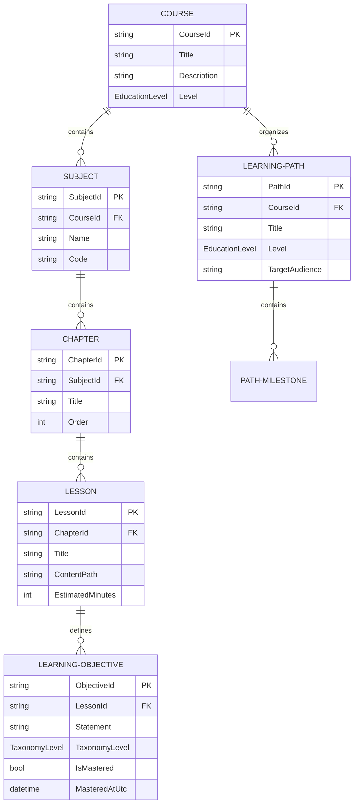
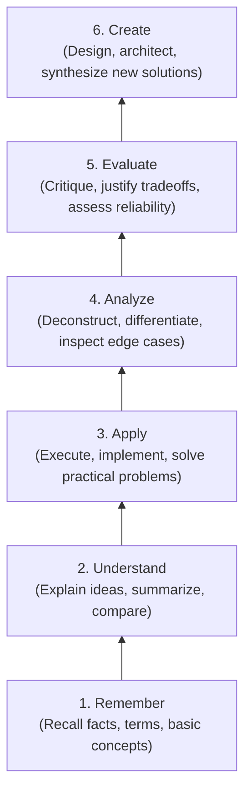

# SPARK Study Division — Course Domain & Curriculum Specification
**Phase 2: Core Learning & AI Tutor**
*Document Version: 2.0.0 | Date: November 2026*

---

## 1. Executive Summary

The SPARK Study Division models academic knowledge through a hierarchical, competency-driven domain graph. Knowledge is structured hierarchically from high-level programs down to atomic lessons, each anchored by rigorous **Learning Objectives** classified under **Bloom's Revised Taxonomy** and orchestrated through **Universal Learning Paths**.

This specification outlines the domain entities, relational models, Bloom's cognitive scaffolding, schema versioning, and ACID persistence layouts established in Phase 2.

---

## 2. Curriculum Domain Hierarchy



---

## 3. Domain Entities

### 3.1 Course (`StudyCourse`)

The root container for an educational syllabus or program.
```csharp
public sealed class StudyCourse
{
    public string CourseId { get; set; } = Guid.NewGuid().ToString("N");
    public string Title { get; set; } = string.Empty;
    public string Description { get; set; } = string.Empty;
    public EducationLevel Level { get; set; } = EducationLevel.College;
    public List<string> SubjectIds { get; set; } = new();
    public DateTime CreatedAtUtc { get; set; } = DateTime.UtcNow;
}
```

### 3.2 Subject (`StudySubject`)

A specialized discipline or field of study within a course (e.g., *Data Structures*, *Computer Architecture*).
```csharp
public sealed class StudySubject
{
    public string SubjectId { get; set; } = Guid.NewGuid().ToString("N");
    public string CourseId { get; set; } = string.Empty;
    public string Name { get; set; } = string.Empty;
    public string Code { get; set; } = string.Empty;
    public List<string> ChapterIds { get; set; } = new();
}
```

### 3.3 Chapter (`StudyChapter`)

A thematic module grouping related concepts and practical exercises.
```csharp
public sealed class StudyChapter
{
    public string ChapterId { get; set; } = Guid.NewGuid().ToString("N");
    public string SubjectId { get; set; } = string.Empty;
    public string Title { get; set; } = string.Empty;
    public int Order { get; set; }
    public List<string> LessonIds { get; set; } = new();
}
```

### 3.4 Lesson (`StudyLesson`)

An atomic pedagogical unit intended for a single study session.
```csharp
public sealed class StudyLesson
{
    public string LessonId { get; set; } = Guid.NewGuid().ToString("N");
    public string ChapterId { get; set; } = string.Empty;
    public string Title { get; set; } = string.Empty;
    public string Summary { get; set; } = string.Empty;
    public int EstimatedMinutes { get; set; } = 30;
    public List<string> ObjectiveIds { get; set; } = new();
}
```

### 3.5 Learning Objective (`LearningObjective`)

Atomic, verifiable mastery targets defined using Bloom's Revised Taxonomy:
```csharp
public sealed class LearningObjective
{
    public string ObjectiveId { get; set; } = Guid.NewGuid().ToString("N");
    public string LessonId { get; set; } = string.Empty;
    public string Statement { get; set; } = string.Empty;
    public TaxonomyLevel TaxonomyLevel { get; set; } = TaxonomyLevel.Understand;
    public bool IsMastered { get; set; }
    public DateTime? MasteredAtUtc { get; set; }
    public int BloomOrder => (int)TaxonomyLevel;
}
```

### 3.6 Learning Path (`LearningPath`)

Sequenced curriculum roadmaps connecting multiple subjects and milestones toward defined educational goals:
```csharp
public sealed class LearningPath
{
    public string PathId { get; set; } = Guid.NewGuid().ToString("N");
    public string CourseId { get; set; } = string.Empty;
    public string Title { get; set; } = string.Empty;
    public string Description { get; set; } = string.Empty;
    public EducationLevel Level { get; set; } = EducationLevel.College;
    public string TargetAudience { get; set; } = string.Empty;
    public List<string> SubjectIds { get; set; } = new();
    public List<LearningPathMilestone> Milestones { get; set; } = new();
    public int EstimatedHours { get; set; } = 40;
}
```

---

## 4. Bloom's Revised Taxonomy Cognitive Framework

The Study Division categorizes every learning objective into one of six cognitive tiers:



| Taxonomy Tier | Enum Value | Pedagogical Focus | AI Tutor Instructional Action |
| :--- | :--- | :--- | :--- |
| **Remember** | `TaxonomyLevel.Remember` | Recall definitions, syntax, formulas | Drills, flashcard-style rapid recall questions |
| **Understand** | `TaxonomyLevel.Understand` | Conceptual explanations, mental models | Conceptual scaffolding, physical analogies, step diagrams |
| **Apply** | `TaxonomyLevel.Apply` | Practical usage, writing code, problem-solving | Concrete coding examples, guided implementation steps |
| **Analyze** | `TaxonomyLevel.Analyze` | Complexity analysis, debugging, comparing | Profiling, trade-off matrix generation, invariant proofs |
| **Evaluate** | `TaxonomyLevel.Evaluate` | Architectural judgment, defense, edge cases | Socratic probing, architectural critiques, code review |
| **Create** | `TaxonomyLevel.Create` | Novel system design, end-to-end integration | Open-ended architectural design prompts, capstone challenges |

---

## 5. Schema Evolution & Versioned Migrations

### 5.1 Version Timeline

| Schema Version | Release | New Collections Added | Migration Action |
| :--- | :--- | :--- | :--- |
| **1.0.0** | Phase 1 | `courses.json`, `subjects.json`, `chapters.json`, `lessons.json`, `sessions.json` | Baseline directory setup and seeding of foundational CS course. |
| **1.1.0** | Phase 2 | `learning_objectives.json`, `learning_paths.json` | Migrates legacy data, seeds Universal Learning Paths across education tiers, anchors objectives to existing lessons. |

### 5.2 Migration Execution Protocol

The `StudyDatabaseMigrations` runner executes on store initialization:
1. Reads `metadata.json` to determine the installed schema version.
2. If version < `1.1.0`, sequentially executes migration routines.
3. Automatically provisions `learning_objectives.json` and `learning_paths.json`.
4. Seeds canonical learning paths:
   - **Path 1**: *Core Computer Science Foundations* (College / B.Tech).
   - **Path 2**: *Higher Secondary Computer Science & Algorithmic Problem Solving* (Pre-University / +2).
5. Seeds Bloom's taxonomy objectives linked to initial lessons (e.g., BST traversal and operations).
6. Atomically updates `metadata.json` with `version: "1.1.0"` and `migratedAtUtc`.

---

## 6. Storage Layout & Validation Rules

### 6.1 User Data Isolation Layout
```
%LOCALAPPDATA%\Spark\Study\{userId}\
    ├── metadata.json              # Version: 1.1.0
    ├── courses.json               # Course definitions
    ├── subjects.json              # Subjects per course
    ├── chapters.json              # Chapters per subject
    ├── lessons.json               # Lessons per chapter
    ├── learning_objectives.json   # Bloom's objectives & mastery status
    ├── learning_paths.json        # Curated progression paths
    └── sessions.json              # Interactive tutor dialogues
```

### 6.2 Data Integrity Invariants
1. **Referential Validity**: A `LearningObjective` must reference a valid `LessonId`. A `StudyLesson` must reference a valid `ChapterId`.
2. **Mastery Immutability**: Setting `IsMastered = true` records `MasteredAtUtc`. Toggling mastery off clears the timestamp.
3. **Fail-Closed Persistence**: Any JSON schema corruption halts store startup with an informative diagnostics event rather than silently discarding user progress.
