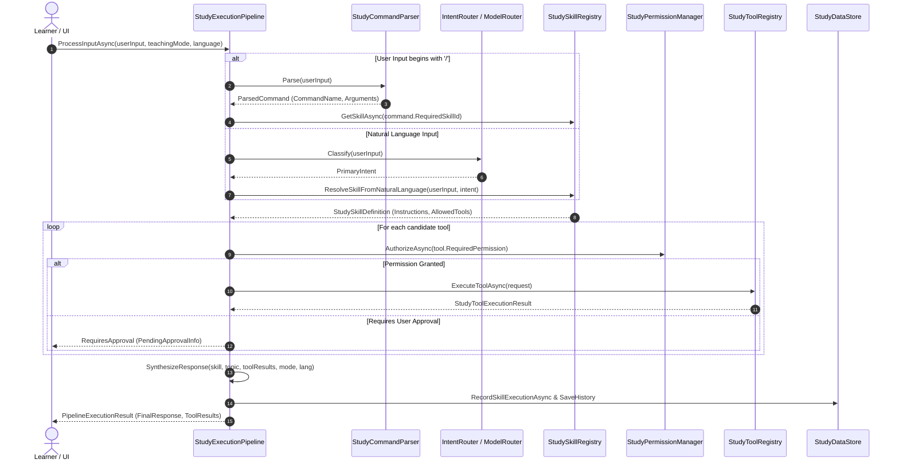

# SPARK Study Division — Unified Execution Pipeline

## 1. Architectural Philosophy
In traditional educational bots, slash commands and natural language chats follow separate code paths. This leads to configuration drift, duplicate permission rules, and inconsistent audit trails.

**SPARK implements One Unified Execution Pipeline (`StudyExecutionPipeline`)**. Both slash commands and natural language inquiries pass through the identical deterministic pipeline:

```
User Input
    │
    ▼
[Intent & Command Resolution]
    │
    ▼
[Skill Selection & Context Assembly]
    │
    ▼
[Tool Selection & Permission Check]
    │
    ▼
[Tool Execution & Timeout Guard]
    │
    ▼
[Pedagogical Response Synthesis]
    │
    ▼
Learner Response + Audit Persistence
```

---

## 2. Sequence Diagram



---

## 3. Pipeline Stages Deconstructed

### Stage 1: Input & Intent Resolution
- **Slash Commands**: The input is parsed into canonical command name, typed key-value pairs, and positional arguments. Required arguments are validated.
- **Natural Language**: If no `/` prefix is present, `StudyEducationalIntentRouter` classifies the intent into categories (`ConceptExplanation`, `ProblemSolvingPractice`, `SummaryAndSynthesis`, `SocraticTutoring`, `ReferenceLookup`, `CodeDebugging`, etc.).

### Stage 2: Skill Selection & Context Assembly
- If `forceSkillId` is specified, it takes absolute precedence.
- Otherwise, the command's `RequiredSkillId` or the natural language intent resolver selects the optimal skill definition.
- The pipeline verifies that the selected skill is active (`IsEnabled == true`). If disabled, it falls back gracefully to `concept-explainer`.
- Active curriculum topic, student grade level, and pedagogical mode are injected into the contextual prompt.

### Stage 3: Tool Whitelist & Permission Gating
- The selected skill strictly restricts which tools may be invoked via `skill.AllowedTools`. Even if a user asks for a tool, it will not run if outside the skill's whitelist.
- For each approved tool, `IStudyPermissionManager.AuthorizeAsync` checks the user's role and permission tier.
- If the tool requires manual approval (`CodeExecution`, `DestructiveOperation`), the pipeline pauses and yields `RequiresApproval = true` with a pending approval token.

### Stage 4: Execution & Timeout Guard
- Approved tools run concurrently or sequentially through `IStudyToolRegistry.ExecuteToolAsync`.
- Each invocation runs with a per-tool timeout token (default 5,000 ms).
- Structured output is captured in `StudyToolExecutionResult`.

### Stage 5: Response Synthesis & Multilingual Output
- The system synthesizes the final pedagogical answer combining:
  - Skill preamble instructions (e.g. Socratic guiding questions vs direct step-by-step breakdown).
  - Intermediate tool computation results (e.g. quadratic roots or statistical tables).
  - Selected `TeachingMode` (`Standard`, `Socratic`, `Adaptive`, `ExamPreparation`).
  - Selected `LearningLanguage` (English, Malayalam).
- The pipeline records complete execution history to `StudyDataStore`.
