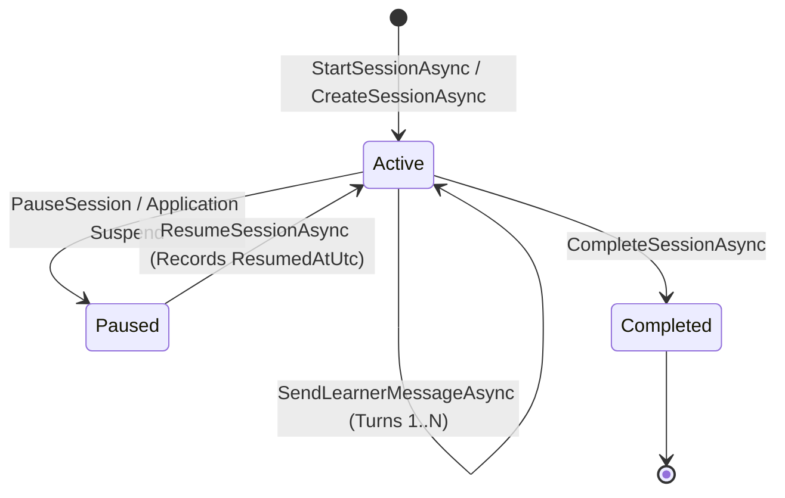

# SPARK Study Division — Core Learning Architecture
**Phase 2: Core Learning & AI Tutor**
*Document Version: 2.0.0 | Date: November 2026*

---

## 1. Executive Summary

Phase 2 of the SPARK Study Division elevates the Phase 1 architectural foundation into a fully functional, pedagogical AI learning engine. The system delivers universal educational coverage spanning primary and secondary schooling through doctoral research, powered by an adaptive AI Tutor supporting 8 distinct pedagogical modes and bilingual instruction (English & Malayalam).

All operations remain strictly bounded by SPARK's local security model:
- **Execution Mode**: Strictly manual, user-initiated execution (fail-closed).
- **Autonomous Background Execution**: Prohibited in Phase 2.
- **Data Persistence**: Local, ACID-atomic, user-isolated storage with versioned schema migrations (1.1.0).

---

## 2. Universal Education Domain Spectrum

The architecture models learners across seven distinct educational tiers:

| Educational Tier | Target Demographic | Primary Pedagogical Scaffolding |
| :--- | :--- | :--- |
| **School** | Grades 6–10 | Relatable everyday analogies, physical metaphors, visual intuition, low cognitive overhead. |
| **HigherSecondary** | +1, +2 / Pre-University | Conceptual rigor, board and competitive entrance alignment, systematic problem-solving. |
| **College** | Undergraduate (B.Tech, B.Sc) | Formal discipline terminology, algorithmic analysis, software architecture patterns. |
| **University** | Graduate / Post-Graduate | Deep theoretical foundations, distributed topologies, research synthesis. |
| **Professional** | Industry Software Engineers | Real-world reliability, performance trade-offs, operational best practices. |
| **Technical** | Applied & Vocational IT | Concrete lab exercises, actionable tool usage, hands-on diagnostics. |
| **Research** | Doctoral & Scientific Inquiry | Formal proofs, asymptotic bounds, open research hypotheses, empirical verification. |

---

## 3. High-Level Component Architecture

```mermaid
graph TD
    UI[WinUI 3 Study Workspace<br/>StudyPage.xaml] --> Service[StudyDivisionService Facade]
    Service --> API[StudyApiService<br/>/api/v1/study/*]
    Service --> Tutor[StudyTutorService<br/>AI Tutor Engine]
    Service --> Store[StudyDataStore<br/>ACID Atomic Store]
    Service --> Bus[StudyEventBus<br/>In-Memory Domain Bus]

    Tutor --> Prompts[StudyTeachingPrompts<br/>8 Modes + Multilingual]
    Tutor --> Router[ISparkModelRouter<br/>SPARK Model Routing]
    Tutor --> Fallback[Local Pedagogical Fallback]

    Store --> Migrations[StudyDatabaseMigrations<br/>v1.0.0 & v1.1.0]
    Store --> Disk[Local User Storage<br/>%APPDATA%/Spark/Study/{userId}/]
```

---

## 4. Multi-Turn Learning State Machine



---

## 5. Security & Boundary Guardrails

1. **User Isolation**:
   - Every file operation is segmented by `userId` under `%APPDATA%\Spark\Study\{userId}\`.
   - Access attempts across user boundaries are rejected immediately with `NOT_FOUND` or `FORBIDDEN`.
2. **Fail-Closed Fallback**:
   - If model routing fails, offline networks occur, or API quota is exceeded, `StudyTutorService` seamlessly yields structured local educational responses without crashing or leaking sensitive data.
3. **No Unsanctioned Background Execution**:
   - The Study Division runs synchronously with user actions; no unsolicited background threads or cron workers operate without explicit user consent.
