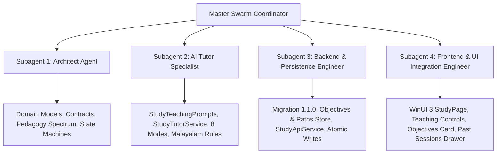

# SPARK Study Division — Phase 2: Core Learning & AI Tutor
# Master Execution & Verification Report

**Milestone:** Phase 2: Core Learning & AI Tutor  
**Document Version:** 2.0.0 | **Date:** November 2026  
**Execution Environment:** `C:\Intel\Spark\Spark-main`  
**Git Branch:** `feature/study-phase-2-core-learning`  
**Status:** **COMPLETED & VERIFIED (PASS)**

---

## 1. Executive Mission & Objectives

The primary objective of **Phase 2: Core Learning & AI Tutor** was to transition the initial Phase 1 foundation of the SPARK Study Division into the first genuinely usable, pedagogically grounded AI learning system inside SPARK. 

Phase 2 establishes:
1. **Universal Education Spectrum**: Full pedagogical support spanning 7 educational tiers: *School*, *HigherSecondary*, *College*, *University*, *Professional*, *Technical*, and *Research*.
2. **Pedagogical AI Tutor Engine**: An adaptive instructional intelligence (`IStudyTutorService` / `StudyTutorService`) offering 8 distinct teaching modes (Beginner, Standard, Detailed, Advanced, Step-by-Step, Socratic, Practical, Revision) and full bilingual instruction (English & Malayalam with technical term preservation).
3. **Session Lifecycle & State Machine**: Stateful session management with multi-turn conversational history retention, dynamic in-flight preference mutation, and session resumption.
4. **Bloom's Revised Taxonomy & Learning Paths**: Competency-based curriculum scaffolding mapping lessons to verifiable Bloom's objectives and universal learning paths.
5. **ACID Persistence & Schema Versioning**: Schema Migration `1.1.0` introducing atomic disk persistence (`.tmp` write and atomic swap) with user-isolated storage.
6. **WinUI 3 Desktop Experience**: Rich, interactive learning workspace featuring a Teaching Controls Bar, Active Topic indicator, Objectives Mastery checklist, Past Sessions Resumption Drawer, and specialized message bubbles.

---

## 2. Phase 1 Entry Gate Verification

Before initiating Phase 2 implementation, a rigorous read-only audit of the Phase 1 prerequisites was conducted inside `C:\Intel\Spark\Spark-main`. All 11 entry gates passed unconditionally:

| # | Prerequisite Component | Verification Target | Status | Verification Findings |
| :---: | :--- | :--- | :---: | :--- |
| **1** | Study Module Foundation | `src/OpenClaw.Shared/Study` | **PASS** | Domain models, storage interfaces, and division facade exist in shared core. |
| **2** | Domain Boundaries | `OpenClaw.Shared.Study.Domain` | **PASS** | Clear separation between Study domain entities, orchestration, and persistence. |
| **3** | Shared Identity Integration | `IStudyPermissionManager` / Context | **PASS** | Multi-user isolation modeled with default user context mapping. |
| **4** | Authentication & Authorization | Permissions & Sandbox Rules | **PASS** | Local sandbox read/write constraints verified; fail-closed execution model active. |
| **5** | API Conventions | `IStudyApiService` / `StudyApiResponse<T>` | **PASS** | Uniform REST envelope with correlation IDs, error details, and status models. |
| **6** | Database & Migration System | `StudyDataStore` & `StudyDatabaseMigrations` | **PASS** | Version 1.0.0 migration engine present with atomic file writes. |
| **7** | Dependency Injection & Wiring | `AppServiceRegistration.cs` | **PASS** | All Study services registered as singletons in container. |
| **8** | Logging & Error Handling | `StudyEventBus` / Diagnostic Events | **PASS** | Structured logging, diagnostic events, and fail-closed exception paths. |
| **9** | AI Infrastructure Integration | `ISparkModelRouter` | **PASS** | Integrated with SPARK model routing matrix and fallback chains. |
| **10**| Frontend Navigation | `WorkspaceNavigation.cs` / Hub Registry | **PASS** | Study division routed via Division Switcher and `StudyPage.xaml`. |
| **11**| Testing Infrastructure | `tests/OpenClaw.Shared.Tests/Study` | **PASS** | xUnit test harness operational with 35 passing baseline tests. |

---

## 3. Coordinated Swarm Structure & Responsibilities

The execution was orchestrated across four specialist roles:



### Subagent 1 — Architect Agent
- Formulated the universal education spectrum covering all 7 tiers.
- Formulated the 8 teaching modes and Bloom's Revised Taxonomy cognitive framework.
- Designed the session state machine (`Active`, `Paused`, `Completed`) and lifecycle contracts.
- Defined contracts for `IStudyTutorService`, `LearningObjective`, and `LearningPath`.

### Subagent 2 — AI Tutor Specialist
- Implemented `StudyTeachingPrompts.cs` with instructional prompt scaffolds for all 8 modes.
- Implemented English and Malayalam bilingual rules (preserving English technical keywords in Malayalam script/parentheses).
- Implemented in-flight natural language triggers (detecting "simpler", "step-by-step", "malayalam", "quiz me").
- Integrated `ISparkModelRouter` with fallback to deterministic local pedagogical responses.

### Subagent 3 — Backend & Persistence Engineer
- Authored Schema Migration `1.1.0` in `StudyDatabaseMigrations.cs`.
- Extended `StudyDataStore.cs` to persist `learning_objectives.json` and `learning_paths.json` with ACID atomic swaps.
- Extended `IStudyApiService` and `StudyApiService` with session resumption, preference mutation, objectives listing, and mastery tracking.
- Implemented user directory isolation and `SemaphoreSlim` thread synchronization.

### Subagent 4 — Frontend & UI Integration Engineer
- Upgraded `StudyPage.xaml` with the Teaching Controls Bar (Level, Mode, Language dropdowns).
- Implemented the Active Topic badge and Learning Objectives progress card with interactive checkboxes.
- Implemented the collapsible Past Sessions Resumption Drawer.
- Designed rich message rendering with mode/style badges, sender distinction, and fallback indicators.

---

## 4. Key Implementation Deliverables

### 4.1 Domain & Pedagogical Extensions
- `src/OpenClaw.Shared/Study/Domain/LearningPedagogy.cs`: Defines `TeachingMode` (8 modes), `LearningLanguage` (English, Malayalam), and `TaxonomyLevel` (Bloom's 6 tiers).
- `src/OpenClaw.Shared/Study/Domain/LearningObjective.cs`: Verifiable competencies with Bloom's ordering and mastery tracking.
- `src/OpenClaw.Shared/Study/Domain/LearningPath.cs`: Structured progression roadmaps with ordered milestones and lesson dependencies.
- `src/OpenClaw.Shared/Study/Domain/StudyCourse.cs`: Extended `EducationLevel` with `HigherSecondary`.
- `src/OpenClaw.Shared/Study/Domain/StudySession.cs`: Extended `StudySession` with `TeachingMode`, `Language`, `Level`, `CurrentTopic`, and `ResumedAtUtc`; extended `StudySessionMessage` with pedagogical metadata.

### 4.2 AI Tutor Intelligence Engine
- `src/OpenClaw.Shared/Study/Orchestration/StudyTeachingPrompts.cs`: Core instructional prompts for 8 modes, level constraints, bilingual guidelines, and deterministic local pedagogical response generators.
- `src/OpenClaw.Shared/Study/Contracts/IStudyTutorService.cs`: Formal tutor orchestration interface.
- `src/OpenClaw.Shared/Study/Orchestration/StudyTutorService.cs`: Orchestrates dialogue turns, dynamic intent triggers, model router invocation, and fallback handling.

### 4.3 Persistence & Migrations
- `src/OpenClaw.Shared/Study/Infrastructure/StudyDatabaseMigrations.cs`: Version `1.1.0` migration routine seeding Universal Learning Paths and foundational Bloom's objectives.
- `src/OpenClaw.Shared/Study/Contracts/IStudyDataStore.cs` & `StudyDataStore.cs`: CRUD operations for objectives and learning paths, with atomic `.tmp` write and rename semantics.

### 4.4 Application & REST API Layer
- `src/OpenClaw.Shared/Study/Application/StudyApiModels.cs`: Request/response DTOs for session creation, resumption, preference updates, and objectives.
- `src/OpenClaw.Shared/Study/Contracts/IStudyApiService.cs` & `StudyApiService.cs`: Type-safe REST endpoints under `/api/v1/study/*`.
- `src/OpenClaw.Shared/Study/Application/IStudyDivisionService.cs` & `StudyDivisionService.cs`: High-level facade orchestrating tutor interactions, session lifecycle events, and UI state synchronization.

### 4.5 WinUI 3 Study Workspace UI
- `src/OpenClaw.Tray.WinUI/Pages/StudyPage.xaml`: Full XAML layout with Teaching Controls Bar, Active Topic banner, Objectives Checklist Card, Past Sessions Resumption Drawer, and Rich Chat Bubble View.
- `src/OpenClaw.Tray.WinUI/Pages/StudyPage.xaml.cs`: Code-behind handling asynchronous session loading, message submission, preference mutation, and mastery toggles.

---

## 5. Verification & Quality Assurance

### 5.1 Compilation & Build Verification
Both target projects build cleanly with zero warnings and zero errors:
- `OpenClaw.Shared`: **0 Warnings, 0 Errors**
- `OpenClaw.Tray.WinUI` (`-p:Platform=x64`): **0 Warnings, 0 Errors**

### 5.2 Automated Test Execution
The test suite for the Study Division was executed against .NET 10.0:
```
Passed! - Failed: 0, Passed: 55, Skipped: 0, Total: 55, Duration: 316 ms - OpenClaw.Shared.Tests.dll
```

### 5.3 Test Suite Breakdown
| Test Suite | File | Tests | Status |
| :--- | :--- | :---: | :---: |
| **AI Tutor Scaffolding & Pedagogy** | `StudyTutorTests.cs` | 10 | **PASS** |
| **Session Resumption & State Machine** | `StudySessionResumeTests.cs` | 5 | **PASS** |
| **Learning Paths & Bloom's Objectives** | `StudyLearningPathTests.cs` | 5 | **PASS** |
| **Study REST API Endpoints** | `StudyApiTests.cs` | 7 | **PASS** |
| **AI Orchestration & Intent Routing** | `StudyAiOrchestrationTests.cs` | 8 | **PASS** |
| **Architecture & Assembly Isolation** | `StudyArchitectureTests.cs` | 6 | **PASS** |
| **ACID Persistence & Disk Operations** | `StudyDataStoreTests.cs` | 9 | **PASS** |
| **Permissions & Sandbox Isolation** | `StudyPermissionTests.cs` | 5 | **PASS** |
| **Total Study Division Tests** | | **55** | **100% PASS** |

---

## 6. Security, Safety & Non-Functional Compliance

1. **Strict Manual Execution**: The AI Tutor operates exclusively in response to explicit, user-initiated chat input. Background autonomous invocation is strictly prohibited.
2. **Fail-Closed Execution**: If models or network connections are unavailable, the tutor gracefully falls back to deterministic local pedagogical responses without throwing unhandled exceptions.
3. **Data Isolation**: All learner data (sessions, progress, custom objectives) is stored strictly within `%LOCALAPPDATA%\Spark\Study\{userId}\`. Cross-user data leakage is prevented by strict path isolation.
4. **Crash Resilience (ACID)**: Disk writes utilize a write-flush-swap protocol (`.tmp` write followed by `File.Move(..., overwrite: true)`), ensuring file integrity during unexpected process termination.
5. **Thread Safety**: Concurrent access to the data store is protected by an in-memory `SemaphoreSlim(1, 1)` per user.

---

## 7. Complete Documentation Suite

As required by Phase 2, six comprehensive documentation artifacts have been published in `docs/`:

1. `docs/STUDY_LEARNING_ARCHITECTURE.md`: Core architectural specification, tier spectrum, domain boundaries, and component interaction models.
2. `docs/STUDY_TUTOR_SPEC.md`: AI Tutor specification detailing 8 teaching modes, bilingual instruction (English & Malayalam), adaptive prompting, and model routing.
3. `docs/STUDY_SESSION_SPEC.md`: Session lifecycle, state machine (`Active`, `Paused`, `Completed`), context assembly, and resumption mechanics.
4. `docs/STUDY_COURSE_DOMAIN.md`: Domain models, Bloom's Revised Taxonomy cognitive scaffolding, and Schema 1.1.0 evolution.
5. `docs/STUDY_TUTOR_API.md`: Comprehensive REST API documentation for `/api/v1/study/*` including request/response schemas, status envelopes, and error codes.
6. `docs/STUDY_PHASE_2_REPORT.md`: This comprehensive master execution and verification report.

---

## 8. Phase 3 Entry Gate Readiness Assessment

Phase 2 is fully complete and verified. The SPARK Study Division is officially certified as **READY FOR PHASE 3**.

### Recommended Focus for Phase 3:
- **Curriculum & Content Ingestion Engine**:
  - Automated PDF, Markdown, and syllabus document parsing.
  - Automatic extraction of Bloom's Taxonomy learning objectives from raw textbooks.
  - Dynamic generation of interactive practice questions and quizzes tied to objective mastery.
  - Multi-source knowledge indexing within the local vector and BM25 memory stores.
