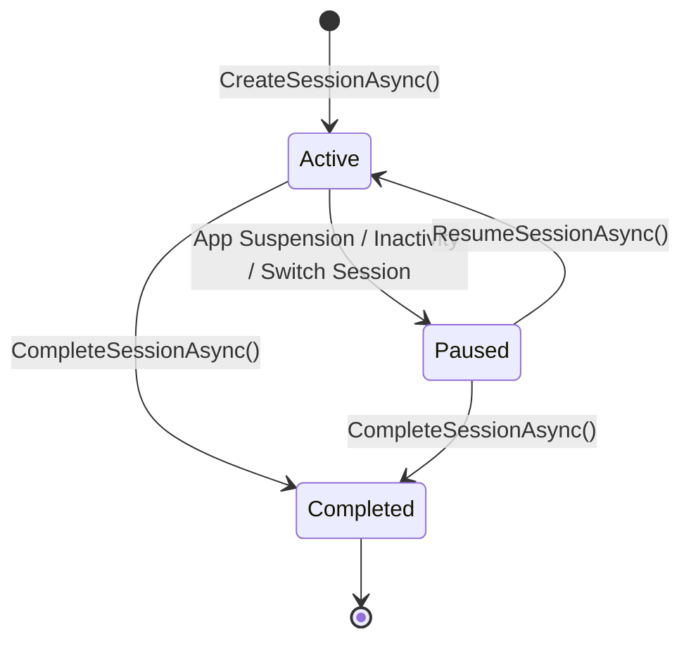
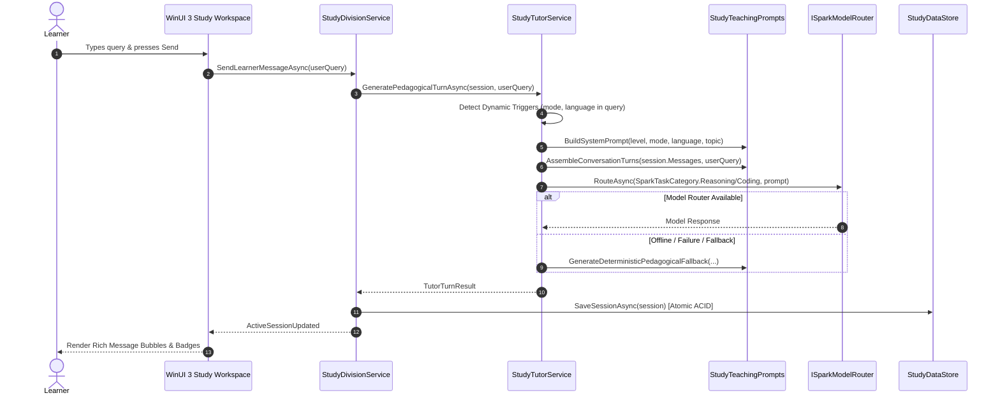

# SPARK Study Division — Session Lifecycle & Persistence Specification
**Phase 2: Core Learning & AI Tutor**
*Document Version: 2.0.0 | Date: November 2026*

---

## 1. Executive Summary

In the SPARK Study Division, a **Study Session** (`StudySession`) represents a bounded, stateful pedagogical engagement between a learner and the AI Tutor. Unlike transient chat conversations, a study session maintains deep pedagogical context: educational tier, teaching mode, instructional language, active topic, lesson objectives, and multi-turn conversational dialogue.

This specification details the end-to-end session lifecycle, state transitions, conversational context assembly, atomic persistence mechanisms, thread safety, and session resumption mechanics.

---

## 2. Session Domain Model

### 2.1 Entity Definition (`StudySession`)

Located in `src/OpenClaw.Shared/Study/Domain/StudySession.cs`:

```csharp
public sealed class StudySession
{
    public string SessionId { get; set; } = Guid.NewGuid().ToString("N");
    public string UserId { get; set; } = string.Empty;
    public string CourseId { get; set; } = string.Empty;
    public string? SubjectId { get; set; }
    public string? LessonId { get; set; }
    public string? CurrentTopic { get; set; }
    public EducationLevel Level { get; set; } = EducationLevel.College;
    public TeachingMode TeachingMode { get; set; } = TeachingMode.Standard;
    public LearningLanguage Language { get; set; } = LearningLanguage.English;
    public StudySessionStatus Status { get; set; } = StudySessionStatus.Active;
    public DateTime StartedAtUtc { get; set; } = DateTime.UtcNow;
    public DateTime LastActiveAtUtc { get; set; } = DateTime.UtcNow;
    public DateTime? ResumedAtUtc { get; set; }
    public List<StudySessionMessage> Messages { get; set; } = new();
    public Dictionary<string, string> Metadata { get; set; } = new();
}
```

### 2.2 Session Message Model (`StudySessionMessage`)

Each dialogue turn is captured with full pedagogical metadata:

```csharp
public sealed class StudySessionMessage
{
    public string MessageId { get; set; } = Guid.NewGuid().ToString("N");
    public string Sender { get; set; } = "user"; // "user", "tutor", "system"
    public string Content { get; set; } = string.Empty;
    public DateTime TimestampUtc { get; set; } = DateTime.UtcNow;
    public TeachingMode? TeachingMode { get; set; }
    public string? ExplanationStyle { get; set; }
    public LearningLanguage? Language { get; set; }
    public string? ModelUsed { get; set; }
    public bool IsFallback { get; set; }
    public Dictionary<string, string> Metadata { get; set; } = new();
}
```

---

## 3. Session State Machine

A study session transitions through a finite set of statuses:



### 3.1 State Definitions

| State | Enum Value | Description |
| :--- | :--- | :--- |
| **Active** | `StudySessionStatus.Active` | The session is currently loaded into the active workspace. Messages can be sent and received in real time. |
| **Paused** | `StudySessionStatus.Paused` | The session has been superseded by another session or suspended during application close. Preserves exact history, mode, language, and topic. |
| **Completed** | `StudySessionStatus.Completed` | The learner has marked the learning session as finished. The session is retained for review and analytics but marked terminal. |

### 3.2 State Transition Invariants

1. **Active to Paused**: When a new session is created or an existing session is resumed, any currently active session for that user transitions to `Paused` and has its `LastActiveAtUtc` updated.
2. **Paused to Active (Resumption)**: Calling `ResumeSessionAsync(userId, sessionId)` validates session ownership, sets `Status = StudySessionStatus.Active`, sets `ResumedAtUtc = DateTime.UtcNow`, and updates `LastActiveAtUtc`.
3. **Preferences Mutation**: Session preferences (`TeachingMode`, `Language`, `Level`, `CurrentTopic`) may be updated dynamically while the session is `Active` without invalidating conversational history.

---

## 4. Multi-Turn Dialogue & Context Assembly

### 4.1 Turn Execution Flow



### 4.2 Context Window Management & Budgeting

To ensure the AI Tutor does not exceed token context boundaries or degrade coherence during extended multi-hour sessions, `StudyTutorService` enforces a sliding context strategy:
1. **Core Instructional Header**: Always includes the pedagogical system rules (8 modes, Malayalam technical-term rules, educational tier constraints).
2. **Curriculum Anchor**: Includes the active course, subject, and lesson learning objectives (Bloom's taxonomy).
3. **Recent Dialogue Window**: The last 10 conversational turns ($5$ user inquiries, $5$ tutor explanations) are included verbatim.
4. **Older Dialogue Summary**: For sessions exceeding 20 turns, older turns are pruned while preserving the learner's initial goal and current topic.

---

## 5. ACID Persistence & Concurrency

### 5.1 Storage Layout

Sessions are persisted inside the user's isolated local data directory:
```
%LOCALAPPDATA%\Spark\Study\{userId}\
    ├── metadata.json
    ├── courses.json
    ├── subjects.json
    ├── chapters.json
    ├── lessons.json
    ├── learning_objectives.json
    ├── learning_paths.json
    └── sessions.json
```

### 5.2 Atomic Write Pattern (ACID Guarantee)

To guarantee crash resilience and eliminate file corruption during abrupt shutdowns:
1. Serialize the updated session collection to JSON.
2. Write to a temporary file (`sessions.json.tmp.{Guid}`).
3. Force write buffer flush to physical disk (`FileStream.Flush(true)`).
4. Atomically replace the target file via `File.Move(tempFile, targetFile, overwrite: true)`.

### 5.3 Thread Safety

All file operations inside `StudyDataStore` are synchronized per user via an in-memory `SemaphoreSlim(1, 1)`:
- Parallel API requests queue safely on the semaphore.
- Concurrent reads and writes never interleave at the filesystem level.
- Unhandled disk I/O exceptions trigger automatic rollback of temporary files.

---

## 6. Session Resumption & UI Integration

### 6.1 Resumption Workflow

1. The WinUI 3 `StudyPage` features a collapsible **Past Sessions Drawer**.
2. When opened, it queries `GetSessionsAsync(userId)`:
   - Displays session topic, education level, teaching mode, message count, and last active timestamp.
3. Clicking **Resume** on any card:
   - Invokes `StudyDivisionService.ResumeSessionAsync(sessionId)`.
   - Re-populates the chat transcript with all prior messages.
   - Syncs the Teaching Controls bar (Mode, Level, Language dropdowns) to the resumed session's exact preferences.
   - Refreshes the associated Learning Objectives card for the session's active lesson.

### 6.2 Dynamic In-Flight Preference Updates

A learner can adjust controls at any point during an ongoing session:
- Changing the **Teaching Mode** dropdown immediately updates `session.TeachingMode`.
- Changing the **Language** dropdown toggles between English and Malayalam.
- Changing the **Level** dropdown adjusts conceptual depth.
- The UI calls `UpdateActiveSessionPreferencesAsync(...)`, which writes changes atomically to `sessions.json` so that subsequent prompts immediately reflect the new scaffolding without losing conversational continuity.
